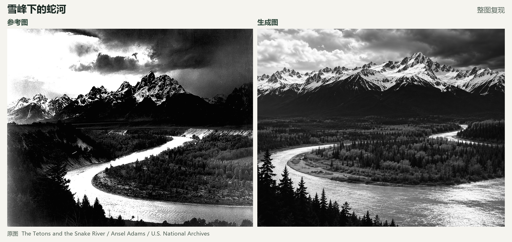
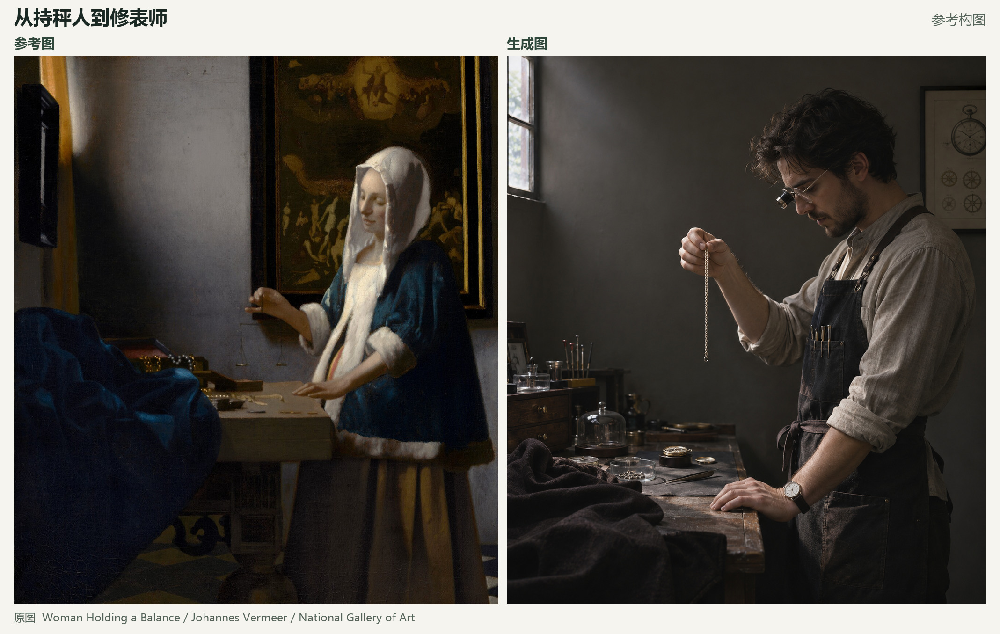

# Image Prompt Reverse

<p align="center"><a href="#中文">中文</a> · <a href="#english">English</a></p>

<a id="中文"></a>

## 中文

上传一张参考图，告诉 Codex 你想保留什么：复现整张图、借画风换题材，或借构图换主体。`$image-prompt-reverse` 会把关键视觉关系写成可直接使用的生图提示词。也可以带回生成结果，请它只修正画偏的部分。

**[浏览完整案例画廊 → 17 组对比与提示词](gallery/README.md)**

### 精选案例

每张对比图左侧为参考图，右侧为纯文字生成结果。图下保留当时实际提交的中文正向词，英文译文与可选负面词可展开复制。

#### 整图复现 · 雪峰下的蛇河

[](gallery/cases/snake-river/comparison.jpg)

**中文正向提示词 · 实际输入**

```text
5:4横幅黑白风景摄影，从高处俯瞰林地间的河湾。明亮河水由右下边缘宽阔地进入，沿下方横向向左回弯，在画面左下三分之一处绕出一个大弧，再向右上收窄，消失在右侧中景林带。近处黑色针叶树剪影压住左下角。深黑山脚横贯中央，锯齿状覆雪山脊位于上半部，最高的山峰在中心偏右。上方云层左白右暗，局部雪面和水面接近纯白，保留林地的灰阶层次。
```

<details>
<summary>英文正向译文与可选负面词（未用于此图）</summary>

**英文正向**

```text
A 5:4 black-and-white landscape photograph from a high vantage point above a wooded bend in a river. A broad band of bright water enters at the lower right edge and sweeps left across the bottom, forming a wide bend near the lower left third. It narrows toward the upper right and disappears into the trees in the right middle distance. Dark conifer silhouettes anchor the lower left corner. Deep black mountain foothills span the center. A jagged snow-covered ridge occupies the upper half, with the tallest peak just right of center. The clouds are bright on the left and dark on the right. Parts of the snow and water approach pure white, while the forest retains a range of grays.
```

**中文负面**

```text
彩色调色，倒置的河湾，最高峰靠左，水面漆黑，林区暗部完全堵死
```

**英文负面**

```text
color grading, reversed river bend, tallest peak on the left, pitch-black water, fully blocked forest shadows
```

</details>

河从右下进入，向左回弯，再收向右侧林地。成图保住了河道走向，山脊比原图更高。 [案例文件与来源](gallery/cases/snake-river)

#### 参考构图 · 从持秤人到修表师

[](gallery/cases/watch-restorer/comparison.jpg)

**中文正向提示词 · 实际输入**

```text
约7:8竖幅的彩色纪实照片，现代钟表修复师站在画面右半，身体向左侧转，头微低，视线落在画面中央的手指上。一手在胸下高度悬提一条细表链，另一手轻抵腰高工作台的前沿。人物从头到大腿入画，左半部上方是大片空墙和左上角窄窗，下方是工作台与深色堆布。背后右上有窄黑框挂图。左上柔窗光落在鼻梁、手指和细链上，工作室其余部分较暗。
```

<details>
<summary>英文正向译文与可选负面词（未用于此图）</summary>

**英文正向**

```text
A documentary color photograph in a roughly 7:8 portrait frame. A modern watch restorer stands on the right, turned toward the left, head slightly lowered and gaze fixed on the fingers at the center of the frame. One hand suspends a fine watch chain just below chest level. The other rests lightly against the front edge of a waist-high workbench. The figure is visible from head to thighs. In the upper left, leave a large expanse of plain wall and a narrow window in the corner. The workbench and a heap of dark fabric occupy the lower left. A print in a narrow black frame hangs behind the figure at upper right. Soft window light from the upper left catches the bridge of the nose, the fingers and the chain. The rest of the workshop is dim.
```

**中文负面**

```text
正面直视镜头，身体朝右，人物居中，双手举到肩部，天平，左侧墙面堆满工具
```

**英文负面**

```text
looking straight at the camera, body turned right, centered subject, both hands at shoulder height, balance scale, tools covering the left wall
```

</details>

把室内油画换成纪实照片，沿用右侧低头的人物、左上窗光和居中的手势。成图中两只手的高差比原画更大。 [案例文件与来源](gallery/cases/watch-restorer)

#### 参考画风 · 从校园漫画到钟表铺

[](gallery/cases/clockmakers-manga/comparison.jpg)

**中文正向提示词 · 实际输入**

```text
3:4竖幅的黑白日式短篇漫画页，主题是两位成年钟表匠修好一只闹钟。页首用夸张粗黑手绘字写“准点！”。上排两格、下排一格通栏：右上中景画两位工匠俯身在工作台边，左上特写画一人听见机芯咔哒响、眼睛睁大；下格以前景左侧的两个人物肩背框住右侧振铃的闹钟。对白泡内只写“响了！”。用轻快的黑墨轮廓、简化圆润的五官、实黑头发与白色留亮，袖褶和背景用稀疏短排线，少量平灰区分前后，纸白占大部分。
```

<details>
<summary>英文正向译文与可选负面词（未用于此图）</summary>

**英文正向**

```text
A 3:4 portrait page from a short black-and-white Japanese-style manga about two adult watchmakers repairing an alarm clock. Use exaggerated, bold, hand-drawn black lettering for the title “准点！” at the top. Place two panels above one full-width bottom panel. In the upper right, show both watchmakers in a medium shot leaning over the bench. In the upper left, show a close-up of one widening their eyes on hearing the movement click. In the lower panel, the shoulders and backs of the two figures in the left foreground frame the ringing alarm clock on the right. The speech bubble contains only “响了！”. Use lively black ink contours, simple rounded facial features, solid black hair with white highlights, sparse short hatching on sleeves and background, and touches of flat gray to separate depth planes. Leave most of the paper white.
```

**中文负面**

```text
彩色页面，四格等分，底部通栏被拆开，英文替代中文，重复对白泡，校服人物
```

**英文负面**

```text
color page, four equal panels, bottom panel split in two, English replacing the Chinese text, duplicate speech balloons, characters in school uniforms
```

</details>

把校园情节换成修钟故事，保留三格叙事和黑白用墨。成图写对了标题与对白，线条比参考图粗。 [案例文件与来源](gallery/cases/clockmakers-manga) · [原作 Kasuga](https://commons.wikimedia.org/wiki/File:Wikipe-tan_manga_page1.jpg) · [CC BY-SA 3.0](https://creativecommons.org/licenses/by-sa/3.0/)

### 支持类型

- 摄影：人像、产品、纪实、食物、动物、自然和城市风景
- 插画：扁平、二次元、治愈、手绘、国风和赛博风格
- 3D：写实、半写实、卡通、黏土、潮玩和产品渲染
- 字体、Logo、海报、平面设计和抽象图形
- IP角色、Q版角色、盲盒和多主体混合画面

### 输出内容

默认给出语义一致的中英文正向提示词。篇幅随画面复杂度调整，优先交代决定相似度的主体、位置、遮挡和媒介特征。目标工具支持独立负面词且有具体偏差需要排除时，再提供负面词。用户可以指定单语、长度或输出格式。

### 安装

将本仓库目录复制到 Codex 的个人 Skills 目录：

```text
%USERPROFILE%\.codex\skills\image-prompt-reverse
```

或直接克隆：

```cmd
git clone https://github.com/LunarXuan/image-prompt-reverse.git "%USERPROFILE%\.codex\skills\image-prompt-reverse"
```

安装后可使用 `$image-prompt-reverse` 调用。

### 文件结构

```text
SKILL.md                         Skill 主入口
references/analysis-framework.md 通用图片分析框架
references/category-guides.md    分类专项分析规则
references/illustration-style.md 插画画风专项
gallery/README.md                案例画廊
agents/openai.yaml               Codex 调用界面配置
```

### 友情链接

欢迎访问 [LINUX DO](https://linux.do/latest)，浏览社区最新主题与讨论。

<a id="english"></a>

## English

`image-prompt-reverse` is a Codex Skill for reverse-engineering image-generation prompts from user-uploaded reference images. It analyzes the image purpose, medium, subject, composition, camera language, lighting, color, materials, background, spatial depth, mood, and post-processing style, then produces high-fidelity prompts that can be used directly with AI image-generation tools.

### Supported image types

- Photography: portraits, products, documentary images, food, animals, nature, and cityscapes
- Illustration: flat, anime, therapeutic, hand-drawn, Chinese-inspired, and cyberpunk styles
- 3D: realistic, semi-realistic, cartoon, clay, designer toys, and product rendering
- Typography, logos, posters, graphic design, and abstract graphics
- IP-inspired characters, chibi characters, blind-box figures, and mixed-subject scenes

### Output

Ask for a whole-image recreation, a new subject in the reference style, or a new scene with the same composition. The Skill returns Chinese and English positive prompts by default. Length follows the scene. A separate negative prompt is included when the target tool supports it and a specific error warrants it. Bring a generated image back to revise the relevant wording.

[Browse all 17 reference/result pairs and their prompts](gallery/README.md).

### Installation

Copy this repository into your personal Codex Skills directory:

```text
%USERPROFILE%\.codex\skills\image-prompt-reverse
```

Or clone it directly:

```cmd
git clone https://github.com/LunarXuan/image-prompt-reverse.git "%USERPROFILE%\.codex\skills\image-prompt-reverse"
```

Invoke it with `$image-prompt-reverse` after installation.

### File structure

```text
SKILL.md                         Skill entry point
references/analysis-framework.md Shared image-analysis framework
references/category-guides.md    Category-specific analysis rules
references/illustration-style.md Illustration style analysis
gallery/README.md                Example gallery
agents/openai.yaml               Codex invocation metadata
```

### Friendly Link

Visit [LINUX DO](https://linux.do/latest) to browse the community’s latest topics and discussions.
