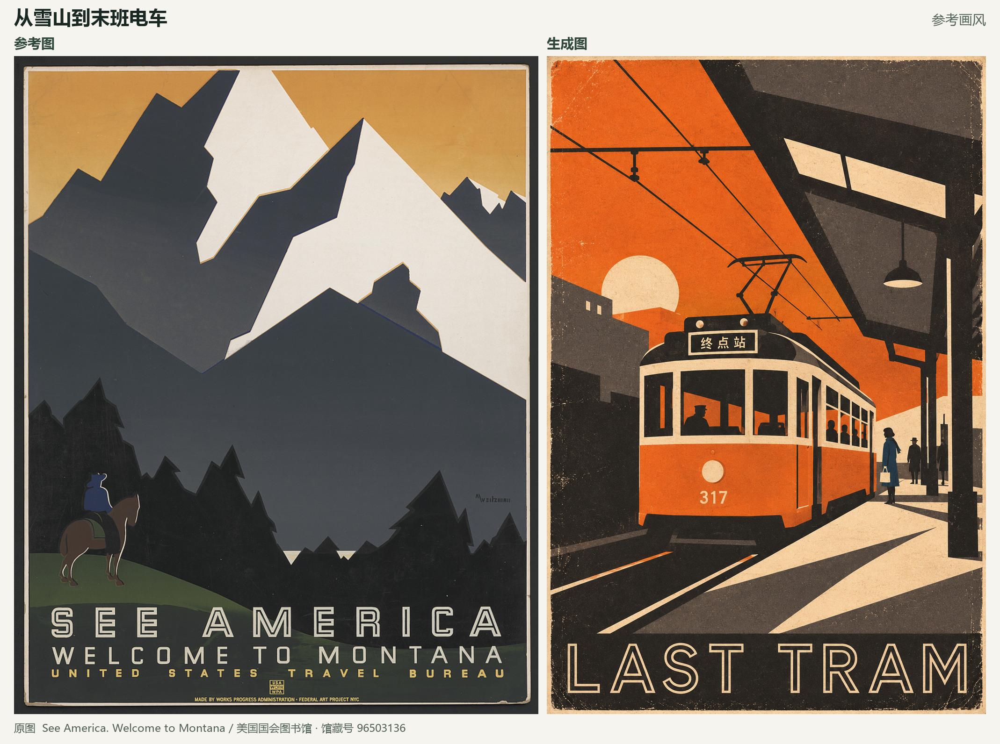
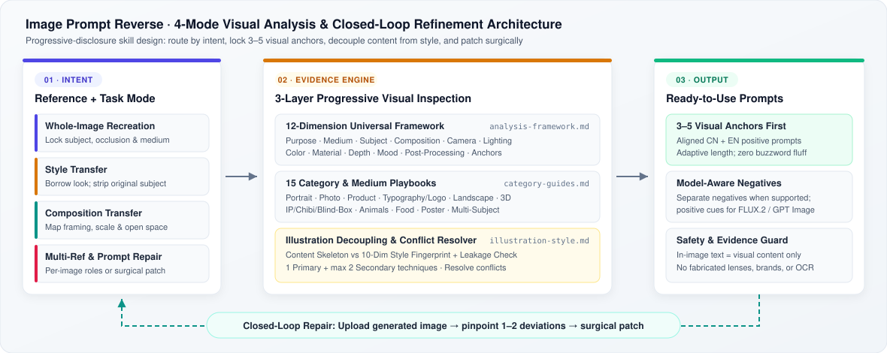
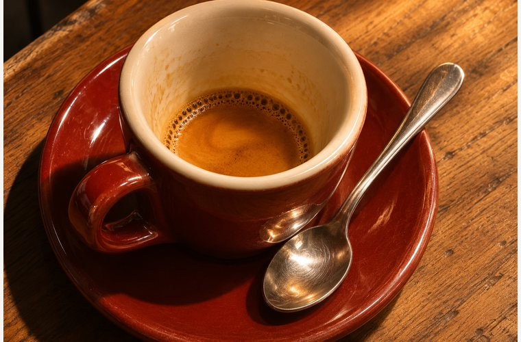
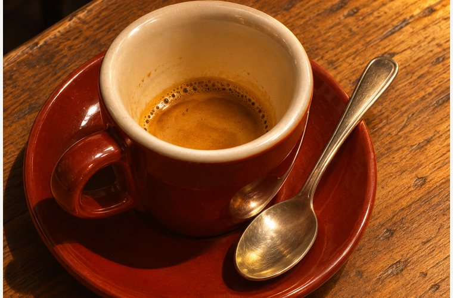
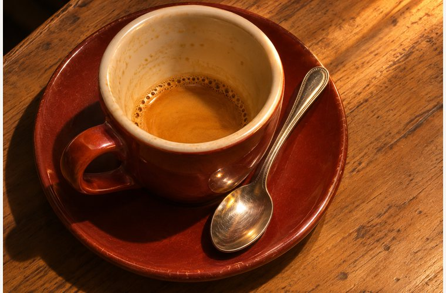
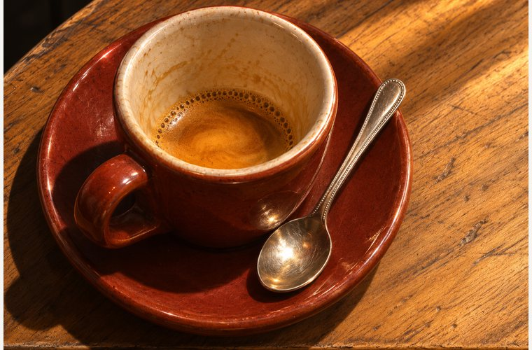
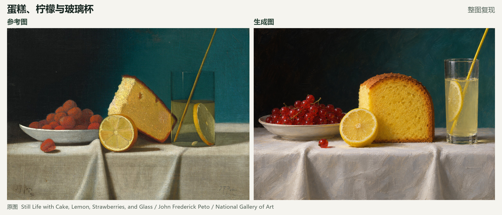
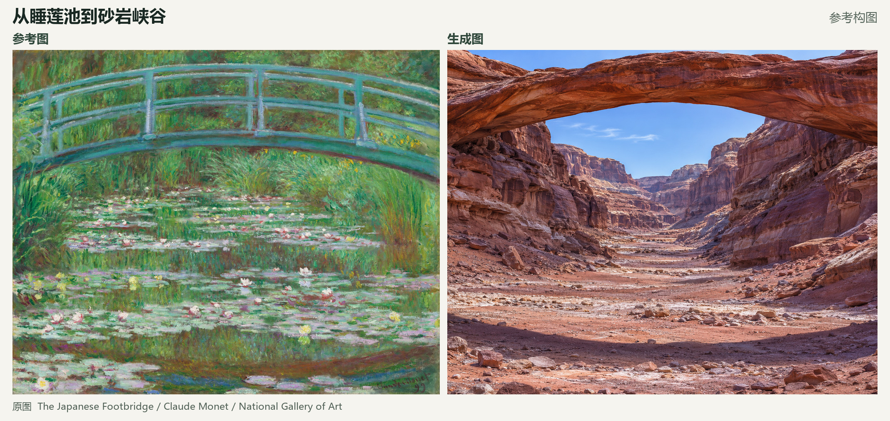
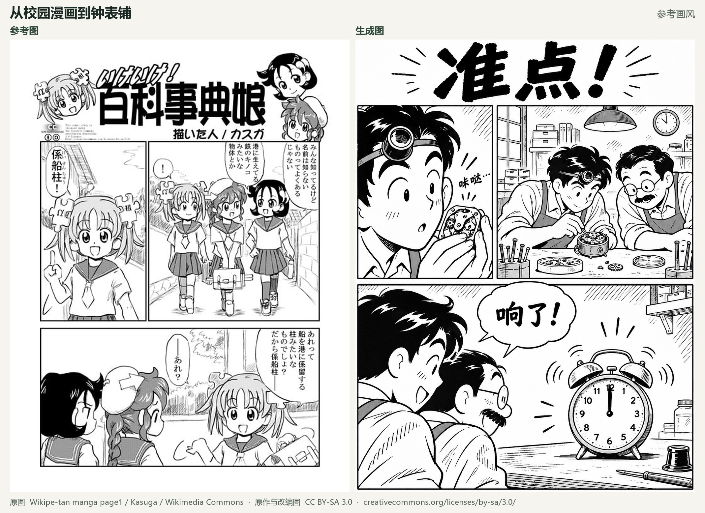

<div align="center">

# Image Prompt Reverse

**面向 AI 生图的高还原度参考图反推 Skill：整图复现 · 画风迁移 · 构图复用 · 成图定点修词**

简体中文 · [English](README_EN.md)

[](#快速开始) [](#四大核心模式与-30-秒速查) [](gallery/README.md) [](#分析架构与核心规则) [](LICENSE)

*不止是泛泛的“看图说话”——开篇锁定最影响相似度的 3–5 个视觉锚点，将“内容骨架”与“画风指纹”拆开处理，生成跑偏时也能对照成图定点修词。*

[一眼看效果](#一眼看效果三种典型任务实测) · [核心差异](#为什么比直接让大模型看图写词更准) · [四大模式](#四大核心模式与-30-秒速查) · [分析架构](#分析架构与核心规则) · [精选案例与修词实验](#精选对比案例与成图修词实验) · [快速开始](#快速开始) · [完整 17 组画廊](gallery/README.md)

</div>

---

## 一眼看效果：三种典型任务实测

> 以下右侧样图均由生图工具**仅凭本 Skill 输出的纯文字中文正向词**生成（左为参考图，右为生成图，点击图片可看原图）：

<table>
  <thead>
    <tr>
      <th width="33%">整图复现 · 雪峰下的蛇河</th>
      <th width="33%">参考画风 · 从雪山到末班电车</th>
      <th width="33%">参考构图 · 从持秤人到修表师</th>
    </tr>
  </thead>
  <tbody>
    <tr>
      <td align="center" valign="middle">
        <a href="gallery/cases/snake-river/comparison.jpg"></a>
      </td>
      <td align="center" valign="middle">
        <a href="gallery/cases/last-tram/comparison.jpg"></a>
      </td>
      <td align="center" valign="middle">
        <a href="gallery/cases/watch-restorer/comparison.jpg"></a>
      </td>
    </tr>
    <tr>
      <td align="center" valign="top"><sub>保留河湾走势、左下树影、主峰位置与黑白影调</sub></td>
      <td align="center" valign="top"><sub>迁移丝网版画硬边色块与空心标题，零雪山/骑手残留</sub></td>
      <td align="center" valign="top"><sub>将维米尔油画的站位、双手高差与左上窗光映射到现代纪实照</sub></td>
    </tr>
  </tbody>
</table>

<p align="center">
  <a href="#精选对比案例与成图修词实验">查看 6 组精选案例与实际提示词 ↓</a> · <a href="gallery/README.md">浏览完整 17 组对照画廊 →</a>
</p>

---

## 为什么比“直接让大模型看图写词”更准？

普通的“看图说话”或标签反推器常常堆砌空洞的氛围词、臆造相机参数，或者在借鉴画风时把原图题材一并带进新画面。`image-prompt-reverse` 通过结构化视觉证据提取解决这些高频痛点：

| 常见痛点 | 直接看图描述 / 标签反推器 | **Image Prompt Reverse** |
| :--- | :--- | :--- |
| **遮挡错位** | 只罗列物体清单，生成时容易左右互换或遮挡颠倒 | **视觉锚点前置**：开篇先锁死 3–5 个最决定相似度的位置、占比与遮挡关系 |
| **画风串题** | 借油画风画贝壳，结果带进了原图的玫瑰和花瓶 | **内容与画风解耦**：剥离原题材名词并做泄漏自检，提炼 10 维可迁移画风指纹 |
| **抽象堆砌** | 堆满 `cinematic, masterpiece, vintage, 8k` | **用可见特征替代形容词**：自动消解冲突技法（如扁平矢量与厚涂油画） |
| **臆造参数** | 凭空编造 `85mm f/1.4`、`Octane Render` 或画师名 | **零脑补纪律**：无证据时只写透视、景深与光影效果，不编造设备、品牌或模糊小字 |
| **负面失效** | 机械输出固定负面词，在 FLUX.2 / GPT Image 中失效 | **模型自适应**：不支持独立负面词时转为正向可见约束；且不误杀原图刻意颗粒或柔焦 |
| **难局部改** | 只能整段重写，修好细节却丢掉原本正确的构图 | **成图定点修词**：对照原图、成图与旧词，只改 1–2 处根因句，保留已生效描述 |
| **指令注入** | 容易把图片里的文字或说明误当作指令执行 | **图内文字隔离**：图中所有文字、Logo 与说明仅作视觉内容处理，绝不作为指令执行 |

---

## 四大核心模式与 30 秒速查

| 使用场景 | 调用示例 | 核心处理逻辑 |
| :--- | :--- | :--- |
| **整图复现**<br/><sub>默认</sub> | `用 $image-prompt-reverse 反推这张风景照，保留河道走向、山脊位置和明暗关系。` | 锁定主体、媒介、构图占比与多主体遮挡关系，输出语义一致的中英双语正向词 |
| **参考画风** | `沿用这张旅行海报的套色和字形，把雪山骑手换成末班电车。` | 提取线条、色块、笔触、明暗与肌理，彻底剔除原题材人物、道具与情节 |
| **参考构图** | `借用这幅画的人物位置、手势和左侧留白，主体换成修表师。` | 迁移画幅、占比、裁切、朝向、遮挡、留白与文字区域，材质与媒介随新任务重构 |
| **成图修词** | `图一是原图，图二是生成结果。杯碟底边被裁掉了，请只改构图那一句。` | 定位最影响还原度的 1–2 处偏差，保留已奏效语句，输出修订后的完整词或替换句 |
| **多图组合** | `参考图一的配色和图二的布局，生成一张赛博风格的咖啡店海报。` | 按图号明确每张参考图负责的维度与冲突取舍；纯文本模式则确保脱离原图独立可用 |

> **输出约定**：默认返回语义一致的 **中文 + 英文正向提示词**，篇幅随画面复杂度自适应；当目标工具支持独立负面词且存在具体偏差需要排除时，再附 `Negative Prompt`。支持按需指定单语、关键词列表或固定长度。

---

## 分析架构与核心规则

<div align="center">
  
</div>

本 Skill 采用 **三层按需加载架构**（Progressive Disclosure），按参考图的实际媒介动态读取对应规则，既保证专业度，又不冗余占用上下文：

1. **主路由与证据纪律**（[`SKILL.md`](SKILL.md)）：负责四模式意图分流、3–5 个视觉锚点前置、主视觉标题与附属 Logo 分级规则、图内文字防注入隔离以及模型自适应负面词策略。
2. **12 维通用分析框架**（[`references/analysis-framework.md`](references/analysis-framework.md)）：仅用于内部分析，覆盖用途、媒介、主体、构图（严格按 `宽:高` 标注）、镜头透视、光线、色彩、材质、景深空间、内容情绪、后期画质与视觉锚点。
3. **15 类专项清单 + 插画 10 维画风指纹**：
   - [`references/category-guides.md`](references/category-guides.md)：覆盖人像、摄影、产品商拍、字体/Logo、风景/城市、建筑室内、插画、3D 渲染、IP/Q 版/潮玩/盲盒、动物、食物、交通工具、植物花卉、平面海报、抽象/多主体混合 15 套专项规则，只激活画面实际存在的类别。
   - [`references/illustration-style.md`](references/illustration-style.md)：仅在插画为主媒介时加载，执行 **内容骨架与画风指纹解耦**、**内容泄漏检查** 及 **1 主 2 辅冲突消解**（覆盖媒介、线条系统、形状语言、明暗塑形、色彩语法、笔触肌理、细节分配、氛围、构图节奏与后期 10 个维度）。

---

## 精选对比案例与成图修词实验

### 成图修词对照实验：只补两句占比与边距，两次复测均解决裁边偏差

在 [`gallery/README.md#coffee-study`](gallery/README.md#coffee-study) 的对照测试中，原词连续生成两次都出现了 **红碟底边被裁切** 的问题；使用本 Skill 的 **成图修词模式**，在不推翻其余有效描述的前提下，仅补写杯口直径占比、碟宽占比与四周边距后，两次重新生成均完整露出了碟边与底边木桌：

| 原词 · 第 1 次（底边被裁） | 原词 · 第 2 次（底边被裁） | 修订词 · 第 1 次（完整碟边） | 修订词 · 第 2 次（完整碟边） |
| :---: | :---: | :---: | :---: |
| [](gallery/cases/coffee-original-1/generated.png) | [](gallery/cases/coffee-original-2/generated.png) | [](gallery/cases/coffee-revised-1/generated.png) | [](gallery/cases/coffee-revised-2/generated.png) |

<details>
<summary><b>展开查看修词前后的核心改动句子</b></summary>

- **原词（引起画面过满与裁边）**：`一只红棕色厚瓷小杯连同同色圆碟占满画面中央略偏左的位置……红碟几乎碰到底边。`
- **修订词（精确锚定占比与边距）**：`一只红棕色厚瓷小杯连同同色圆碟完整落在画面中央略偏左的位置……杯口横向直径约为画宽的五分之二，上沿距顶边约二十分之一画高……红碟宽约占全画宽的三分之二，四边完整可见，底边留一线木桌，右侧露出约五分之一画宽的桌面。`

</details>

---

### 六组精选对比案例（含实际输入正向词）

> 每张对比图左侧为参考图，右侧为纯文字生成结果。下方保留当时实际提交的中文正向提示词，英文译文与可选负面词（未用于样图）可展开复制。

#### 1. 参考画风 · 从雪山到末班电车

[](gallery/cases/last-tram/comparison.jpg)

```text
设计一张“末班电车”主题的竖幅丝网版画海报。主视觉是一辆驶入终点站的老电车，架空电线与站棚切过上方。把车身、站棚、天空和站台概括成几块大的硬边多边形，斜线干脆，远近靠色块重叠拉开；用暖橙、纸白、炭灰和近黑平涂，只在小人物身上点一点暗蓝。保留轻微纸张磨痕、四周窄纸边。底部用米白色双线空心宽间距大写字排一行“LAST TRAM”。
```

<details>
<summary>英文正向译文与可选负面词（未用于此图）</summary>

**英文正向**
```text
Design a portrait-format screen-printed poster about the last tram. An old tram pulls into the terminus beneath overhead wires and a station canopy. Simplify the vehicle, canopy, sky and platform into large hard-edged polygons. Use decisive diagonals and overlapping flat shapes to separate near and far planes. Print in warm orange, paper white, charcoal and near-black, with a small touch of dark blue on the tiny figures. Keep mild paper wear and a narrow paper border. Across the bottom, set “LAST TRAM” on one line in widely spaced ivory double-outline capitals.
```
**中文负面**：`雪山，骑手，写实摄影，渐变天空，密集细碎的装饰线，标题换行`  
**英文负面**：`snowy peaks, horseback rider, photorealism, gradient sky, dense decorative linework, title split across lines`

</details>

#### 2. 整图复现 · 雪峰下的蛇河

[](gallery/cases/snake-river/comparison.jpg)

```text
5:4横幅黑白风景摄影，从高处俯瞰林地间的河湾。明亮河水由右下边缘宽阔地进入，沿下方横向向左回弯，在画面左下三分之一处绕出一个大弧，再向右上收窄，消失在右侧中景林带。近处黑色针叶树剪影压住左下角。深黑山脚横贯中央，锯齿状覆雪山脊位于上半部，最高的山峰在中心偏右。上方云层左白右暗，局部雪面和水面接近纯白，保留林地的灰阶层次。
```

<details>
<summary>英文正向译文与可选负面词（未用于此图）</summary>

**英文正向**
```text
A 5:4 black-and-white landscape photograph from a high vantage point above a wooded bend in a river. A broad band of bright water enters at the lower right edge and sweeps left across the bottom, forming a wide bend near the lower left third. It narrows toward the upper right and disappears into the trees in the right middle distance. Dark conifer silhouettes anchor the lower left corner. Deep black mountain foothills span the center. A jagged snow-covered ridge occupies the upper half, with the tallest peak just right of center. The clouds are bright on the left and dark on the right. Parts of the snow and water approach pure white, while the forest retains a range of grays.
```
**中文负面**：`彩色调色，倒置的河湾，最高峰靠左，水面漆黑，林区暗部完全堵死`  
**英文负面**：`color grading, reversed river bend, tallest peak on the left, pitch-black water, fully blocked forest shadows`

</details>

#### 3. 参考构图 · 从持秤人到修表师

[](gallery/cases/watch-restorer/comparison.jpg)

```text
约7:8竖幅的彩色纪实照片，现代钟表修复师站在画面右半，身体向左侧转，头微低，视线落在画面中央的手指上。一手在胸下高度悬提一条细表链，另一手轻抵腰高工作台的前沿。人物从头到大腿入画，左半部上方是大片空墙和左上角窄窗，下方是工作台与深色堆布。背后右上有窄黑框挂图。左上柔窗光落在鼻梁、手指和细链上，工作室其余部分较暗。
```

<details>
<summary>英文正向译文与可选负面词（未用于此图）</summary>

**英文正向**
```text
A documentary color photograph in a roughly 7:8 portrait frame. A modern watch restorer stands on the right, turned toward the left, head slightly lowered and gaze fixed on the fingers at the center of the frame. One hand suspends a fine watch chain just below chest level. The other rests lightly against the front edge of a waist-high workbench. The figure is visible from head to thighs. In the upper left, leave a large expanse of plain wall and a narrow window in the corner. The workbench and a heap of dark fabric occupy the lower left. A print in a narrow black frame hangs behind the figure at upper right. Soft window light from the upper left catches the bridge of the nose, the fingers and the chain. The rest of the workshop is dim.
```
**中文负面**：`正面直视镜头，身体朝右，人物居中，双手举到肩部，天平，左侧墙面堆满工具`  
**英文负面**：`looking straight at the camera, body turned right, centered subject, both hands at shoulder height, balance scale, tools covering the left wall`

</details>

#### 4. 整图复现 · 蛋糕、柠檬与玻璃杯

[](gallery/cases/cake-and-lemon/comparison.jpg)

```text
约7:5横幅的写实静物油画，白色桌布的前沿横过下三分之一，两道垂直褶皱落向底边。自左到右依次是一只盛满小红浆果的浅白盘、一块拱形黄蛋糕、一只细直透明玻璃杯。蛋糕直立，朝左的窄切面迎光，金黄宽面朝向观者，棕色外皮勾边；半个柠檬在它左前方，圆形切面正对观者，遮住蛋糕的左下角。左前另有一颗散落的红莓。杯中有淡黄色饮料和一片竖立的柠檬，一根细长黄吸管斜向右上，伸出顶边。深色背景由左边近黑过渡到右边蓝绿。
```

<details>
<summary>英文正向译文与可选负面词（未用于此图）</summary>

**英文正向**
```text
A realistic still-life oil painting in a roughly 7:5 landscape frame. The front edge of a white tablecloth crosses the lower third, with two vertical folds dropping toward the bottom. From left to right are a shallow white plate heaped with small red berries, an arched slice of yellow cake, and a slim straight-sided clear glass. The cake stands upright with its narrow left cut face catching the light, its broad golden face toward the viewer and its brown crust tracing the edge. A lemon half in front on the left presents its round cut face directly to the viewer, obscuring the cake’s lower left corner. A single red berry lies loose at front left. The glass contains a pale yellow drink and an upright lemon slice. A long thin yellow straw angles toward the upper right and exits the top edge. The dark background grades from near-black on the left to teal on the right.
```
**中文负面**：`柠檬在蛋糕后方，玻璃杯在左侧，吸管朝左倾斜，圆形整蛋糕，多余的盘碟`  
**英文负面**：`lemon behind the cake, drinking glass on the left, straw leaning left, whole round cake, extra plates`

</details>

#### 5. 参考构图 · 从睡莲池到砂岩峡谷

[](gallery/cases/sandstone-arch/comparison.jpg)

```text
5:4横幅的真实沙漠峡谷照片。画面上四分之一是一道长而低的红砂岩天然石拱，中央略向上隆起，拱身左右都延伸到画外，顶缘接近画面上边。拱洞下面是层层后退的干涸河床，从下沿宽阔的近景收窄到中部，两侧陡起岩壁收住视线。浅色矿物沉积和碎石呈数道断续的横带，近处较宽，向远处逐渐变密；底部一道阴影呼应上方弧线。用沙黄、铁锈红和冷紫阴影表现岩石纹层。
```

<details>
<summary>英文正向译文与可选负面词（未用于此图）</summary>

**英文正向**
```text
A realistic 5:4 landscape photograph of a desert canyon. A long, low natural arch of red sandstone crosses the upper quarter. It rises slightly in the middle, runs beyond both edges, and approaches the top border. Below the opening, a dry riverbed recedes in layers, broad in the immediate foreground and narrowing toward the center. Steep rock walls on either side channel the eye inward. Pale mineral deposits and gravel form interrupted horizontal bands, wider nearby and closer together in the distance. A curved shadow at the bottom echoes the arch above. Sandy yellow, iron red and cool purple shadows bring out the rock strata.
```
**中文负面**：`木桥，栏杆，睡莲，池水，画面中央的大圆拱，大片无细节蓝天`  
**英文负面**：`wooden footbridge, railings, water lilies, pond water, large round arch centered in the frame, broad featureless blue sky`

</details>

#### 6. 参考画风 · 从校园漫画到钟表铺

[](gallery/cases/clockmakers-manga/comparison.jpg)

```text
3:4竖幅的黑白日式短篇漫画页，主题是两位成年钟表匠修好一只闹钟。页首用夸张粗黑手绘字写“准点！”。上排两格、下排一格通栏：右上中景画两位工匠俯身在工作台边，左上特写画一人听见机芯咔哒响、眼睛睁大；下格以前景左侧的两个人物肩背框住右侧振铃的闹钟。对白泡内只写“响了！”。用轻快的黑墨轮廓、简化圆润的五官、实黑头发与白色留亮，袖褶和背景用稀疏短排线，少量平灰区分前后，纸白占大部分。
```

<details>
<summary>英文正向译文与可选负面词（未用于此图）</summary>

**英文正向**
```text
A 3:4 portrait page from a short black-and-white Japanese-style manga about two adult watchmakers repairing an alarm clock. Use exaggerated, bold, hand-drawn black lettering for the title “准点！” at the top. Place two panels above one full-width bottom panel. In the upper right, show both watchmakers in a medium shot leaning over the bench. In the upper left, show a close-up of one widening their eyes on hearing the movement click. In the lower panel, the shoulders and backs of the two figures in the left foreground frame the ringing alarm clock on the right. The speech bubble contains only “响了！”. Use lively black ink contours, simple rounded facial features, solid black hair with white highlights, sparse short hatching on sleeves and background, and touches of flat gray to separate depth planes. Leave most of the paper white.
```
**中文负面**：`彩色页面，四格等分，底部通栏被拆开，英文替代中文，重复对白泡，校服人物`  
**英文负面**：`color page, four equal panels, bottom panel split in two, English replacing the Chinese text, duplicate speech balloons, characters in school uniforms`

</details>

👉 **[浏览完整案例画廊（17 组对照图 + 偏差诚实复盘 + 全部中英 TXT）→](gallery/README.md)**

---

## 快速开始

### 安装（支持 Codex / Claude Code 及兼容 Agent Skills 标准的环境）

**方式 A：在 Codex 中通过 `$skill-installer` 安装（推荐）**

```text
使用 $skill-installer，从 GitHub 仓库 LunarXuan/image-prompt-reverse 安装
image-prompt-reverse。安装后我会在新任务里调用 $image-prompt-reverse。
```

**方式 B：直接克隆到本地技能目录**

```bash
# OpenAI Codex（macOS / Linux）
git clone https://github.com/LunarXuan/image-prompt-reverse.git ~/.codex/skills/image-prompt-reverse

# OpenAI Codex（Windows PowerShell）
git clone https://github.com/LunarXuan/image-prompt-reverse.git "$env:USERPROFILE\.codex\skills\image-prompt-reverse"

# OpenAI Codex（Windows CMD）
git clone https://github.com/LunarXuan/image-prompt-reverse.git "%USERPROFILE%\.codex\skills\image-prompt-reverse"

# Claude Code（兼容开放 Agent Skills 目录规范）
git clone https://github.com/LunarXuan/image-prompt-reverse.git ~/.claude/skills/image-prompt-reverse
```

> 若设置了自定义 `CODEX_HOME`，放入 `$CODEX_HOME/skills/image-prompt-reverse/`。安装后即可通过 `$image-prompt-reverse` 调用（本 Skill 不用于纯文字 OCR 或普通看图聊天）。

---

## 项目结构与版本记录

```text
image-prompt-reverse/
├── README.md                           # 简体中文主页
├── README_EN.md                        # English README
├── SKILL.md                            # Skill 主入口：四模式分流、锚点与安全规则
├── LICENSE                             # GNU GPLv3
├── agents/
│   └── openai.yaml                     # Codex 调用界面与默认提示配置
├── assets/
│   └── workflow-architecture.svg       # 四模式与三层分析架构图
├── references/
│   ├── analysis-framework.md           # 12 维通用图片内部分析框架
│   ├── category-guides.md              # 15 类主体与媒介专项规则
│   └── illustration-style.md           # 插画内容/画风解耦 + 10 维画风指纹 + 冲突消解
└── gallery/
    ├── README.md                       # 17 组完整测试画廊与咖啡杯修词对照
    └── cases/                          # 17 个案例原图、成图、拼接图与四份 UTF-8 TXT
```

<details>
<summary><b>更新记录与初版说明（2026-11-24 更新）</b></summary>

- **2026-11-24**：新增参考画风、参考构图、多参考图分工以及根据成图针对性修词；放开正向提示词字数限制，改为随复杂度自适应，并按目标生图工具决定是否提供独立负面词；补充 17 组完整对照画廊。
- **初版默认格式**：正向 Prompt 为 450–700 中文字符连续自然语言 + 英文等义版本；Negative Prompt 固定为 10–15 条英文逗号分隔词。

</details>

---

## 配套视频反推联动

如果你需要把参考图或参考视频延伸到 **AI 视频生成（I2V / 首尾帧）**，可以配合同系列项目 [**`video-prompt-reverse`**](https://github.com/LunarXuan/video-prompt-reverse) 组成双 Skill 视觉工作流：

1. 用 `$video-prompt-reverse --mode i2v` 拆解参考视频，自动导出干净的各镜首帧与纯动态/运镜提示词；
2. 将首帧交给本 Skill（`$image-prompt-reverse`），通过 **参考构图** 或 **参考画风** 重绘一张无原片版权/主体冲突的新首帧；
3. 把新首帧与 `i2v` 动态提示词送入即梦（Seedance）、可灵（Kling）、海螺（MiniMax）、Veo 或 Wan，即可在保留原片运镜与剪辑节奏的前提下生成全新原创视频。

---

## 友情链接与开源许可

- **友情链接**：欢迎访问 [LINUX DO](https://linux.do/latest)，浏览社区最新主题与讨论。
- **开源许可**：本项目代码与 Skill 规则基于 [GNU General Public License v3.0](LICENSE) 发布；画廊中各参考案例的原始作品版权与署名信息详见 [gallery/README.md](gallery/README.md) 及对应案例目录下的 `source.txt`。
