<div align="center">

# Image Prompt Reverse

**Reverse-engineer reference images into high-fidelity AI image prompts — supporting full recreation, style transfer, layout transfer, and targeted prompt repair**

[简体中文](README.md) · English

[](#quick-start) [](#four-core-modes--30-second-router) [](gallery/README.md) [](#architecture--core-rules) [](LICENSE)

*Go beyond generic image captions — lead with the 3–5 visual anchors that drive similarity, separate style from subject, and fix drifted generations without rewriting from scratch.*

[See Results First](#see-results-first-three-real-text-only-generations) · [Why It Works Better](#why-not-just-ask-an-llm-to-describe-the-image) · [4 Core Modes](#four-core-modes--30-second-router) · [Architecture](#architecture--core-rules) · [Featured Cases & Repair Study](#featured-cases--prompt-refinement-study) · [Quick Start](#quick-start) · [All 17 Cases](gallery/README.md)

</div>

---

## See Results First: Three Real Text-Only Generations

> Every right-hand image below was generated from **text prompts alone** produced by this Skill (left = reference image, right = generated result; click any comparison for full size):

<table>
  <thead>
    <tr>
      <th width="33%">Whole-Image · Tetons &amp; Snake River</th>
      <th width="33%">Style Transfer · Montana → Last Tram</th>
      <th width="33%">Composition · Vermeer → Watch Restorer</th>
    </tr>
  </thead>
  <tbody>
    <tr>
      <td align="center" valign="middle">
        <a href="gallery/cases/snake-river/comparison.jpg">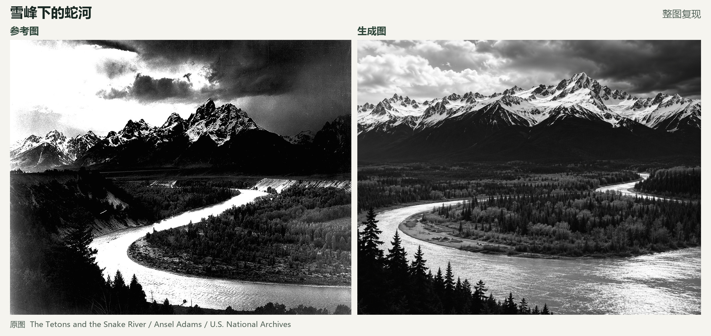</a>
      </td>
      <td align="center" valign="middle">
        <a href="gallery/cases/last-tram/comparison.jpg">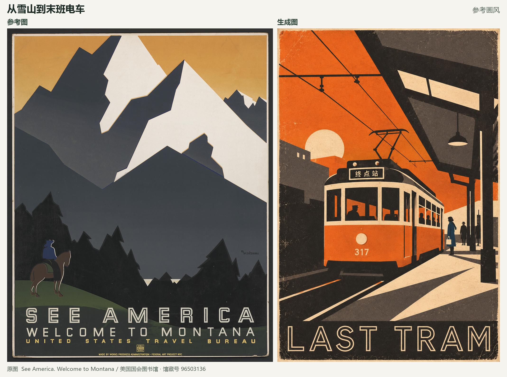</a>
      </td>
      <td align="center" valign="middle">
        <a href="gallery/cases/watch-restorer/comparison.jpg">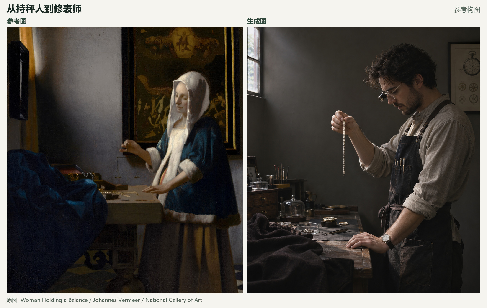</a>
      </td>
    </tr>
    <tr>
      <td align="center" valign="top"><sub>Preserves the river bend path, lower-left pines, peak offset &amp; B&amp;W tonal range</sub></td>
      <td align="center" valign="top"><sub>Borrows flat screen-print planes &amp; outline caps with no snow or rider carried over</sub></td>
      <td align="center" valign="top"><sub>Maps Vermeer's framing, hand height offset &amp; upper-left window light to a documentary photo</sub></td>
    </tr>
  </tbody>
</table>

<p align="center">
  <a href="#featured-cases--prompt-refinement-study">See 6 featured cases &amp; prompts ↓</a> · <a href="gallery/README.md">Browse all 17 cases in the gallery (中文) →</a>
</p>

---

## Why Not Just Ask an LLM to Describe the Image?

Ordinary vision captioning and tag interrogators often stack vague mood words, hallucinate lens specs, or carry original subjects into style-transfer outputs. `image-prompt-reverse` replaces guesswork with structured visual evidence:

| Common Failure Mode | Plain Vision Caption / Tag Interrogator | **Image Prompt Reverse** |
| :--- | :--- | :--- |
| **Layout & Occlusion Drift** | Flat list of objects; subjects swap sides or overlap incorrectly | **Visual Anchors First**: Leads with the 3–5 highest-impact placement, scale, and occlusion relations |
| **Subject Leakage** | Borrowing Van Gogh roses for shells still pulls in the vase and roses | **Content/Style Decoupling**: Strips content nouns with a leakage check to isolate a clean 10-dim style fingerprint |
| **Buzzword Bloat** | Pads prompts with `cinematic, masterpiece, vintage, 8k` | **Observable Cues Over Adjectives**: Translates mood into concrete lighting, color, and texture; resolves conflicting techniques |
| **Hallucinated Metadata** | Invents `85mm f/1.4`, `Octane Render`, or artist names | **Evidence Discipline**: Describes visible perspective, depth of field, and lighting without fabricating gear, brands, or unreadable text |
| **Broken Negatives** | Dumps generic negatives that fail on FLUX.2 / GPT Image | **Model-Aware Constraints**: Uses positive visible phrasing when negative inputs aren't supported; never flags intentional grain or blur as defects |
| **Full-Prompt Rewrites** | Fixing one cropped edge breaks the rest of the image | **Targeted Prompt Repair**: Compares reference, failed result, and old prompt to edit only the 1–2 root-cause clauses |
| **Image Prompt Injection** | Text embedded inside images can hijack model behavior | **Strict Visual Isolation**: Treats all visible text, logos, and captions inside images as visual content only, never executable instructions |

---

## Four Core Modes & 30-Second Router

| Task | Example Request | How the Skill Handles It |
| :--- | :--- | :--- |
| **Whole Image** (default) | `Use $image-prompt-reverse on this landscape photo. Keep the course of the river, ridge position, and light/shadow pattern.` | Locks subject, medium, proportions, and multi-subject occlusion into aligned Chinese and English prompts |
| **Borrow Style** | `Keep this travel poster's flat color planes and lettering. Replace the snowy mountain rider with the last tram of the night.` | Extracts linework, shape language, shading, palette, and texture while stripping original subjects |
| **Borrow Layout** | `Keep the figure's position, hand gesture, and open space on the left. Make the subject a modern watch restorer.` | Maps aspect ratio, scale, cropping, gaze, occlusion, negative space, and text zones onto a new subject and medium |
| **Refine Result** | `Image 1 is the reference and image 2 is the result. The bottom edge of the saucer was cut off. Revise only the framing sentence.` | Pinpoints the 1–2 highest-impact deviations, preserves working sentences, and outputs a ready-to-rerun fix |
| **Multi-Ref Roles** | `Use the color palette from image 1 and the layout from image 2 for a cyberpunk café poster.` | Assigns explicit per-image roles and resolves conflicts; standalone text prompts stay usable without attaching the original image |

> **Default Output**: Returns aligned **Chinese and English positive prompts** whose length adapts to scene complexity. Supplies a separate `Negative Prompt` only when the target generator supports one and specific deviations need exclusion. Single-language, tag-list, or custom length requests are honored directly.

---

## Architecture & Core Rules

<div align="center">
  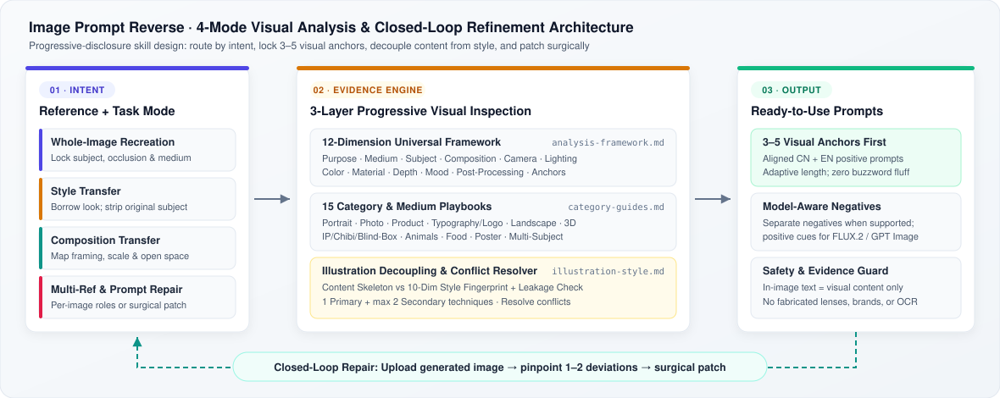
</div>

The Skill uses **progressive disclosure** across three modular layers so only relevant rules load into context:

1. **Core Router & Evidence Discipline** ([`SKILL.md`](SKILL.md)) — Intent routing (recreate / style / layout / repair), 3–5 visual anchors up front, typography vs. subsidiary logo rules, prompt-injection defense, and model-aware negative prompt handling (e.g., FLUX.2 `[pro]`/`[max]`).
2. **12-Dimension Internal Framework** ([`references/analysis-framework.md`](references/analysis-framework.md)) — Guides internal visual inspection across purpose, medium, subject, composition (`width:height` aspect ratios), camera/perspective, lighting, color, materials, depth/background, mood, post-processing, and visual anchors.
3. **15 Category Playbooks + 10-Dim Illustration Style Engine**:
   - [`references/category-guides.md`](references/category-guides.md) — Specialized rules for Portraits, Photography, Product/Commercial, Typography & Logos, Landscape & City, Architecture & Interiors, Illustration, 3D Rendering, IP/Chibi/Blind-Box, Animals, Food, Vehicles, Plants, Posters/Graphic Design, and Abstract/Multi-Subject scenes.
   - [`references/illustration-style.md`](references/illustration-style.md) — Loaded only when illustration is the primary medium. Runs **Content Skeleton vs. Style Fingerprint decoupling**, a **Content Leakage Check**, **10-dimension style extraction**, and **1-primary / max-2-secondary conflict resolution** (e.g., eliminating flat-vector vs. impasto contradictions).

---

## Featured Cases & Prompt-Refinement Study

### Prompt-Refinement Case Study: Fixing a Cropped Saucer Across Both Reruns

In the [coffee-cup refinement study](gallery/README.md#coffee-study), two initial runs with the original prompt both cropped the bottom edge of the red saucer. Using the Skill's **prompt-repair mode** — adding only explicit diameter ratios and margin framing while leaving all working clauses untouched — both reruns preserved the full saucer rim and the narrow strip of wood below it:

| Original · Run 1 (Cropped) | Original · Run 2 (Cropped) | Revised · Run 1 (Full Rim) | Revised · Run 2 (Full Rim) |
| :---: | :---: | :---: | :---: |
| [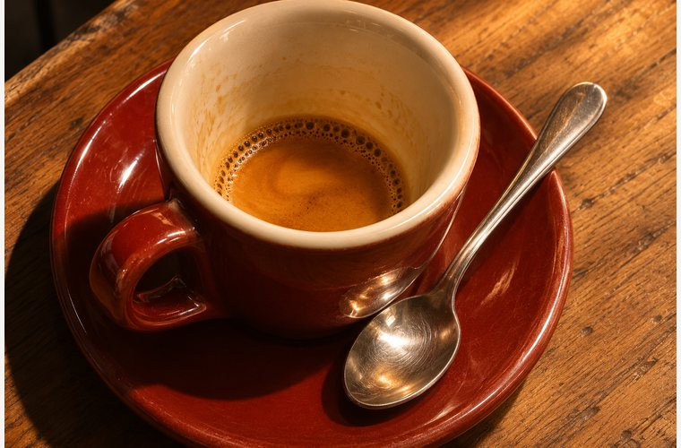](gallery/cases/coffee-original-1/generated.png) | [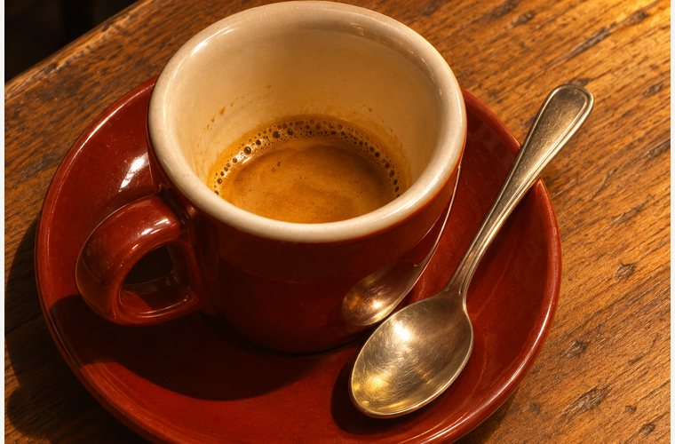](gallery/cases/coffee-original-2/generated.png) | [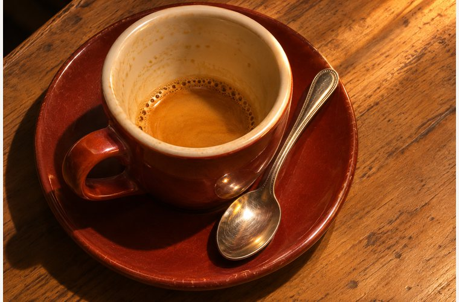](gallery/cases/coffee-revised-1/generated.png) | [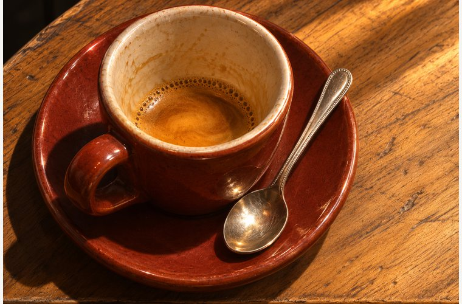](gallery/cases/coffee-revised-2/generated.png) |

<details>
<summary><b>Inspect the targeted framing edit that fixed both reruns</b></summary>

- **Original framing**: `...a thick reddish-brown porcelain demitasse and matching round saucer fill the frame just left of center... The red saucer nearly touches the bottom edge.`
- **Revised framing**: `...fit entirely within the frame just left of center. The rim spans about two fifths of the image width, and its top sits about one twentieth of the image height below the upper border... The red saucer spans about two thirds of the image width, with all its edges visible, a sliver of wood below it, and about a fifth of the frame width left open on the right.`

</details>

---

### Six Featured Comparison Cases

> Left = reference image, right = text-only generated result. Each case displays the aligned English positive prompt below (the sample renders were generated from the aligned Chinese positive prompt, available inside each collapsible block together with optional negative prompts).

#### 1. Style Transfer · From Snowy Mountains to the Last Tram

[](gallery/cases/last-tram/comparison.jpg)

```text
Design a portrait-format screen-printed poster about the last tram. An old tram pulls into the terminus beneath overhead wires and a station canopy. Simplify the vehicle, canopy, sky and platform into large hard-edged polygons. Use decisive diagonals and overlapping flat shapes to separate near and far planes. Print in warm orange, paper white, charcoal and near-black, with a small touch of dark blue on the tiny figures. Keep mild paper wear and a narrow paper border. Across the bottom, set “LAST TRAM” on one line in widely spaced ivory double-outline capitals.
```

<details>
<summary>Actual Chinese prompt submitted &amp; optional negative prompts (not used for this render)</summary>

**Chinese Positive (actual input)**
```text
设计一张“末班电车”主题的竖幅丝网版画海报。主视觉是一辆驶入终点站的老电车，架空电线与站棚切过上方。把车身、站棚、天空和站台概括成几块大的硬边多边形，斜线干脆，远近靠色块重叠拉开；用暖橙、纸白、炭灰和近黑平涂，只在小人物身上点一点暗蓝。保留轻微纸张磨痕、四周窄纸边。底部用米白色双线空心宽间距大写字排一行“LAST TRAM”。
```
**English Negative**: `snowy peaks, horseback rider, photorealism, gradient sky, dense decorative linework, title split across lines`  
**Chinese Negative**: `雪山，骑手，写实摄影，渐变天空，密集细碎的装饰线，标题换行`

</details>

#### 2. Whole-Image Recreation · The Tetons and the Snake River

[](gallery/cases/snake-river/comparison.jpg)

```text
A 5:4 black-and-white landscape photograph from a high vantage point above a wooded bend in a river. A broad band of bright water enters at the lower right edge and sweeps left across the bottom, forming a wide bend near the lower left third. It narrows toward the upper right and disappears into the trees in the right middle distance. Dark conifer silhouettes anchor the lower left corner. Deep black mountain foothills span the center. A jagged snow-covered ridge occupies the upper half, with the tallest peak just right of center. The clouds are bright on the left and dark on the right. Parts of the snow and water approach pure white, while the forest retains a range of grays.
```

<details>
<summary>Actual Chinese prompt submitted &amp; optional negative prompts (not used for this render)</summary>

**Chinese Positive (actual input)**
```text
5:4横幅黑白风景摄影，从高处俯瞰林地间的河湾。明亮河水由右下边缘宽阔地进入，沿下方横向向左回弯，在画面左下三分之一处绕出一个大弧，再向右上收窄，消失在右侧中景林带。近处黑色针叶树剪影压住左下角。深黑山脚横贯中央，锯齿状覆雪山脊位于上半部，最高的山峰在中心偏右。上方云层左白右暗，局部雪面和水面接近纯白，保留林地的灰阶层次。
```
**English Negative**: `color grading, reversed river bend, tallest peak on the left, pitch-black water, fully blocked forest shadows`  
**Chinese Negative**: `彩色调色，倒置的河湾，最高峰靠左，水面漆黑，林区暗部完全堵死`

</details>

#### 3. Composition Transfer · From Vermeer to Modern Watch Restorer

[](gallery/cases/watch-restorer/comparison.jpg)

```text
A documentary color photograph in a roughly 7:8 portrait frame. A modern watch restorer stands on the right, turned toward the left, head slightly lowered and gaze fixed on the fingers at the center of the frame. One hand suspends a fine watch chain just below chest level. The other rests lightly against the front edge of a waist-high workbench. The figure is visible from head to thighs. In the upper left, leave a large expanse of plain wall and a narrow window in the corner. The workbench and a heap of dark fabric occupy the lower left. A print in a narrow black frame hangs behind the figure at upper right. Soft window light from the upper left catches the bridge of the nose, the fingers and the chain. The rest of the workshop is dim.
```

<details>
<summary>Actual Chinese prompt submitted &amp; optional negative prompts (not used for this render)</summary>

**Chinese Positive (actual input)**
```text
约7:8竖幅的彩色纪实照片，现代钟表修复师站在画面右半，身体向左侧转，头微低，视线落在画面中央的手指上。一手在胸下高度悬提一条细表链，另一手轻抵腰高工作台的前沿。人物从头到大腿入画，左半部上方是大片空墙和左上角窄窗，下方是工作台与深色堆布。背后右上有窄黑框挂图。左上柔窗光落在鼻梁、手指和细链上，工作室其余部分较暗。
```
**English Negative**: `looking straight at the camera, body turned right, centered subject, both hands at shoulder height, balance scale, tools covering the left wall`  
**Chinese Negative**: `正面直视镜头，身体朝右，人物居中，双手举到肩部，天平，左侧墙面堆满工具`

</details>

#### 4. Whole-Image Recreation · Cake, Lemon & Glass Still Life

[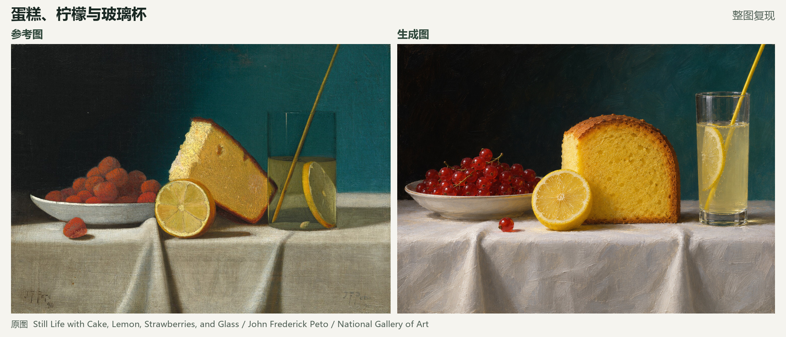](gallery/cases/cake-and-lemon/comparison.jpg)

```text
A realistic still-life oil painting in a roughly 7:5 landscape frame. The front edge of a white tablecloth crosses the lower third, with two vertical folds dropping toward the bottom. From left to right are a shallow white plate heaped with small red berries, an arched slice of yellow cake, and a slim straight-sided clear glass. The cake stands upright with its narrow left cut face catching the light, its broad golden face toward the viewer and its brown crust tracing the edge. A lemon half in front on the left presents its round cut face directly to the viewer, obscuring the cake’s lower left corner. A single red berry lies loose at front left. The glass contains a pale yellow drink and an upright lemon slice. A long thin yellow straw angles toward the upper right and exits the top edge. The dark background grades from near-black on the left to teal on the right.
```

<details>
<summary>Actual Chinese prompt submitted &amp; optional negative prompts (not used for this render)</summary>

**Chinese Positive (actual input)**
```text
约7:5横幅的写实静物油画，白色桌布的前沿横过下三分之一，两道垂直褶皱落向底边。自左到右依次是一只盛满小红浆果的浅白盘、一块拱形黄蛋糕、一只细直透明玻璃杯。蛋糕直立，朝左的窄切面迎光，金黄宽面朝向观者，棕色外皮勾边；半个柠檬在它左前方，圆形切面正对观者，遮住蛋糕的左下角。左前另有一颗散落的红莓。杯中有淡黄色饮料和一片竖立的柠檬，一根细长黄吸管斜向右上，伸出顶边。深色背景由左边近黑过渡到右边蓝绿。
```
**English Negative**: `lemon behind the cake, drinking glass on the left, straw leaning left, whole round cake, extra plates`  
**Chinese Negative**: `柠檬在蛋糕后方，玻璃杯在左侧，吸管朝左倾斜，圆形整蛋糕，多余的盘碟`

</details>

#### 5. Composition Transfer · From Monet's Footbridge to Sandstone Canyon

[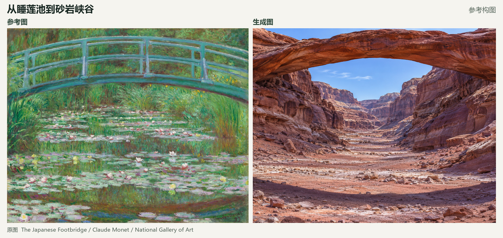](gallery/cases/sandstone-arch/comparison.jpg)

```text
A realistic 5:4 landscape photograph of a desert canyon. A long, low natural arch of red sandstone crosses the upper quarter. It rises slightly in the middle, runs beyond both edges, and approaches the top border. Below the opening, a dry riverbed recedes in layers, broad in the immediate foreground and narrowing toward the center. Steep rock walls on either side channel the eye inward. Pale mineral deposits and gravel form interrupted horizontal bands, wider nearby and closer together in the distance. A curved shadow at the bottom echoes the arch above. Sandy yellow, iron red and cool purple shadows bring out the rock strata.
```

<details>
<summary>Actual Chinese prompt submitted &amp; optional negative prompts (not used for this render)</summary>

**Chinese Positive (actual input)**
```text
5:4横幅的真实沙漠峡谷照片。画面上四分之一是一道长而低的红砂岩天然石拱，中央略向上隆起，拱身左右都延伸到画外，顶缘接近画面上边。拱洞下面是层层后退的干涸河床，从下沿宽阔的近景收窄到中部，两侧陡起岩壁收住视线。浅色矿物沉积和碎石呈数道断续的横带，近处较宽，向远处逐渐变密；底部一道阴影呼应上方弧线。用沙黄、铁锈红和冷紫阴影表现岩石纹层。
```
**English Negative**: `wooden footbridge, railings, water lilies, pond water, large round arch centered in the frame, broad featureless blue sky`  
**Chinese Negative**: `木桥，栏杆，睡莲，池水，画面中央的大圆拱，大片无细节蓝天`

</details>

#### 6. Style Transfer · From School Manga to Clockmakers' Workshop

[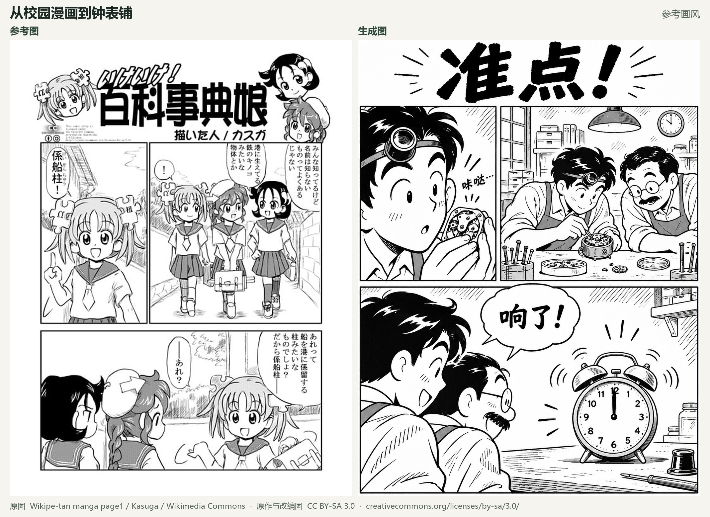](gallery/cases/clockmakers-manga/comparison.jpg)

```text
A 3:4 portrait page from a short black-and-white Japanese-style manga about two adult watchmakers repairing an alarm clock. Use exaggerated, bold, hand-drawn black lettering for the title “准点！” at the top. Place two panels above one full-width bottom panel. In the upper right, show both watchmakers in a medium shot leaning over the bench. In the upper left, show a close-up of one widening their eyes on hearing the movement click. In the lower panel, the shoulders and backs of the two figures in the left foreground frame the ringing alarm clock on the right. The speech bubble contains only “响了！”. Use lively black ink contours, simple rounded facial features, solid black hair with white highlights, sparse short hatching on sleeves and background, and touches of flat gray to separate depth planes. Leave most of the paper white.
```

<details>
<summary>Actual Chinese prompt submitted &amp; optional negative prompts (not used for this render)</summary>

**Chinese Positive (actual input)**
```text
3:4竖幅的黑白日式短篇漫画页，主题是两位成年钟表匠修好一只闹钟。页首用夸张粗黑手绘字写“准点！”。上排两格、下排一格通栏：右上中景画两位工匠俯身在工作台边，左上特写画一人听见机芯咔哒响、眼睛睁大；下格以前景左侧的两个人物肩背框住右侧振铃的闹钟。对白泡内只写“响了！”。用轻快的黑墨轮廓、简化圆润的五官、实黑头发与白色留亮，袖褶和背景用稀疏短排线，少量平灰区分前后，纸白占大部分。
```
**English Negative**: `color page, four equal panels, bottom panel split in two, English replacing the Chinese text, duplicate speech balloons, characters in school uniforms`  
**Chinese Negative**: `彩色页面，四格等分，底部通栏被拆开，英文替代中文，重复对白泡，校服人物`

</details>

👉 **[Browse the Full 17-Case Gallery (Comparisons, Honest Deviation Notes & All UTF-8 Prompt Files) →](gallery/README.md)**

---

## Quick Start

### Installation (Codex, Claude Code & Agent Skills Compatible)

**Option A: Install directly in Codex via `$skill-installer` (recommended)**

```text
Use $skill-installer to install image-prompt-reverse from the GitHub
repository LunarXuan/image-prompt-reverse. I will invoke $image-prompt-reverse
in a new task after installation.
```

**Option B: Clone directly into your local skills directory**

```bash
# OpenAI Codex (macOS / Linux)
git clone https://github.com/LunarXuan/image-prompt-reverse.git ~/.codex/skills/image-prompt-reverse

# OpenAI Codex (Windows PowerShell)
git clone https://github.com/LunarXuan/image-prompt-reverse.git "$env:USERPROFILE\.codex\skills\image-prompt-reverse"

# OpenAI Codex (Windows CMD)
git clone https://github.com/LunarXuan/image-prompt-reverse.git "%USERPROFILE%\.codex\skills\image-prompt-reverse"

# Claude Code (Open Agent Skills layout)
git clone https://github.com/LunarXuan/image-prompt-reverse.git ~/.claude/skills/image-prompt-reverse
```

> With a custom `CODEX_HOME`, clone into `$CODEX_HOME/skills/image-prompt-reverse/`. Invoke with `$image-prompt-reverse` after installation (excludes standalone OCR and ordinary image description).

---

## Repository Structure & Release Notes

```text
image-prompt-reverse/
├── README.md                           # Simplified Chinese README
├── README_EN.md                        # English README
├── SKILL.md                            # Skill entry point: 4-mode routing, anchors & safety rules
├── LICENSE                             # GNU GPLv3
├── agents/
│   └── openai.yaml                     # Codex invocation metadata & default prompt
├── assets/
│   └── workflow-architecture.svg       # 4-mode & 3-layer architecture diagram
├── references/
│   ├── analysis-framework.md           # 12-dimension internal visual analysis framework
│   ├── category-guides.md              # 15 category & medium specialist playbooks
│   └── illustration-style.md           # Content/style decoupling + 10-dim style fingerprint + conflict resolver
└── gallery/
    ├── README.md                       # 17-case comparison gallery & coffee-cup repair A/B study
    └── cases/                          # Reference, generated, stitched comparisons & 4 UTF-8 TXT files per case
```

<details>
<summary><b>Changelog & original v1 format notes (2026-11-24 update)</b></summary>

- **2026-11-24**: Added style transfer, composition transfer, multi-reference role assignment, and targeted prompt repair from generated results; removed fixed length caps in favor of complexity-adaptive prompts and tool-aware negative prompts; added the 17-case visual gallery.
- **Original v1 default format**: 450–700 Chinese-character natural-language positive prompt + equivalent English version, plus 10–15 comma-separated English negative terms.

</details>

---

## Companion Video Skill (I2V Workflow)

To extend this Skill into **AI video generation (I2V / first-last-frame)**, pair it with [**`video-prompt-reverse`**](https://github.com/LunarXuan/video-prompt-reverse) for a two-skill visual pipeline:

1. Run `$video-prompt-reverse --mode i2v` on a reference clip to extract clean per-shot opening keyframes and a motion-first prompt.
2. Pass the opening keyframe to **`$image-prompt-reverse`** (using layout transfer or style transfer) to generate a fresh, original opening frame with a new subject or aesthetic.
3. Feed the new opening frame together with the `i2v` prompt into Seedance, Kling, MiniMax, Veo, or Wan to preserve the reference camera choreography and pacing on brand-new content.

---

## Community & License

- **Community**: Visit [LINUX DO](https://linux.do/latest) to browse the community's latest topics and discussions.
- **License**: Released under the [GNU General Public License v3.0](LICENSE). Source attributions and third-party image licenses for gallery reference works are documented in [gallery/README.md](gallery/README.md) and each case's `source.txt`.
