# 图片反推提示词 · 案例画廊

同一张图可以用来复现整图、借画风或借构图。这里收录两轮测试的 17 次生成。每组左侧是参考图，右侧是生图工具只读中文提示词后生成的结果。点击图片可查看原始尺寸。

中文正向词可直接复制。展开下方的提示词面板可查看英文译文，以及为支持独立负面词输入的工具补写的中英负面词。三者均未用于这些样图。每个案例目录也提供四份 UTF-8 TXT。

[人物](#portraits) · [风景](#landscapes) · [动漫](#anime) · [静物](#still-life) · [海报](#posters) · [咖啡杯修词对照](#coffee-study)

<a name="portraits"></a>

## 人物

### 橙色航天服肖像

**整图复现**　观察颈环、头盔裁切，以及背景中模型与人物的尺度关系。

<table>
<thead><tr><th>参考图</th><th>生成图</th></tr></thead>
<tbody><tr>
<td width="50%" align="center"><a href="cases/astronaut/reference.png">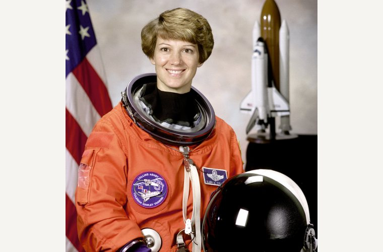</a></td>
<td width="50%" align="center"><a href="cases/astronaut/generated.png"></a></td>
</tr></tbody>
</table>

[下载左右拼接图](cases/astronaut/comparison.jpg)

人物朝向、橙色航天服、宽颈环及左旗右模型的位置正确。右下仍有带白色反光的黑头盔。 成图人物更靠左，右下头盔露出的面积更小。发型、脸形与臂章有变化，还自行补出了清晰的 NASA 字样。

**中文正向 · 实际输入** · [TXT](cases/astronaut/positive.zh.txt)

```text
1:1 方形的彩色棚拍半身肖像。一位成年女性短浅棕发，侧分蓬松，正面露齿微笑，头部在画面上半部略偏左。她穿饱和橙色航天服，黑色高领外套着一圈宽厚的黑银金属颈环，胸前有圆形和矩形布章，中央垂着两条浅色系带。右下前景一顶黑亮球面头盔露出白边，反射两个白色矩形灯斑，下沿和右沿均被画幅裁断。左后方垂落红白蓝旗帜，右后方是竖立的白色航天飞机模型和棕色储箱，黑底座，灰白虚化棚景。
```

<details>
<summary>英文正向与中英负面提示词</summary>

**英文正向 · 译文** · [TXT](cases/astronaut/positive.en.txt)

```text
A square color studio portrait, framed from the waist up. An adult woman with short, voluminous, side-parted light brown hair faces forward with an open smile showing her teeth. Her head sits slightly left of center in the upper half. She wears a saturated orange space suit with a broad black-and-silver metal neck ring around a black high collar. Round and rectangular cloth patches are on the chest, with two pale straps hanging down the center. In the lower right foreground a glossy black spherical helmet with a white rim reflects two rectangular white lights. The helmet is cropped at both the bottom and right edges. A red, white and blue flag hangs behind her on the left. On the right, a white space shuttle model with a brown tank stands on a black base against a softly blurred gray-white studio backdrop.
```

**中文负面 · 可选** · [TXT](cases/astronaut/negative.zh.txt)

```text
头盔戴在头上，头盔移至左下，飞机模型在左侧，多余文字徽标，张嘴大笑
```

**英文负面 · 可选** · [TXT](cases/astronaut/negative.en.txt)

```text
helmet worn on the head, helmet at lower left, shuttle model on the left, extra lettering or logos, wide-open laughing mouth
```

</details>

原图出自 Eileen Collins, astronaut / NASA / scikit-image。[作品来源](https://scikit-image.org/docs/stable/api/skimage.data.html#skimage.data.astronaut) · [案例文件夹](cases/astronaut)

### 从持秤人到修表师

**参考构图**　将单人室内油画转成工作纪实照，保留侧身、双手高差和左侧留白。

<table>
<thead><tr><th>参考图</th><th>生成图</th></tr></thead>
<tbody><tr>
<td width="50%" align="center"><a href="cases/watch-restorer/reference.jpg">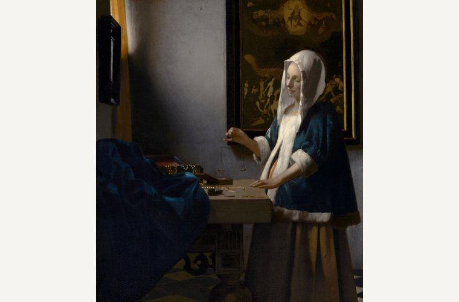</a></td>
<td width="50%" align="center"><a href="cases/watch-restorer/generated.png">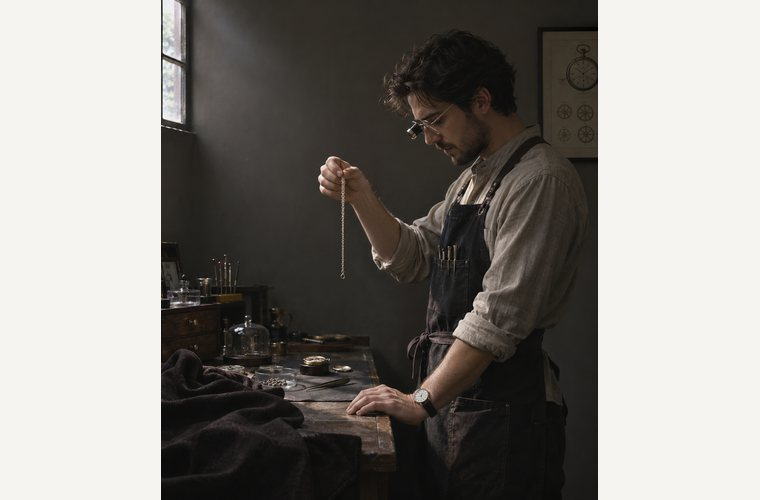</a></td>
</tr></tbody>
</table>

[下载左右拼接图](cases/watch-restorer/comparison.jpg)

左上窗光、右侧低头的人物、居中的悬链和压在工作台前沿的另一只手都成立。左上空墙也保住了。 成图抬高了悬链的手、压低了扶台的手，两手间距比原画大；挂图从成片的暗背景缩成了右上角一小块。

**中文正向 · 实际输入** · [TXT](cases/watch-restorer/positive.zh.txt)

```text
约7:8竖幅的彩色纪实照片，现代钟表修复师站在画面右半，身体向左侧转，头微低，视线落在画面中央的手指上。一手在胸下高度悬提一条细表链，另一手轻抵腰高工作台的前沿。人物从头到大腿入画，左半部上方是大片空墙和左上角窄窗，下方是工作台与深色堆布。背后右上有窄黑框挂图。左上柔窗光落在鼻梁、手指和细链上，工作室其余部分较暗。
```

<details>
<summary>英文正向与中英负面提示词</summary>

**英文正向 · 译文** · [TXT](cases/watch-restorer/positive.en.txt)

```text
A documentary color photograph in a roughly 7:8 portrait frame. A modern watch restorer stands on the right, turned toward the left, head slightly lowered and gaze fixed on the fingers at the center of the frame. One hand suspends a fine watch chain just below chest level. The other rests lightly against the front edge of a waist-high workbench. The figure is visible from head to thighs. In the upper left, leave a large expanse of plain wall and a narrow window in the corner. The workbench and a heap of dark fabric occupy the lower left. A print in a narrow black frame hangs behind the figure at upper right. Soft window light from the upper left catches the bridge of the nose, the fingers and the chain. The rest of the workshop is dim.
```

**中文负面 · 可选** · [TXT](cases/watch-restorer/negative.zh.txt)

```text
正面直视镜头，身体朝右，人物居中，双手举到肩部，天平，左侧墙面堆满工具
```

**英文负面 · 可选** · [TXT](cases/watch-restorer/negative.en.txt)

```text
looking straight at the camera, body turned right, centered subject, both hands at shoulder height, balance scale, tools covering the left wall
```

</details>

原图出自 Woman Holding a Balance / Johannes Vermeer / National Gallery of Art。[作品来源](https://www.nga.gov/artworks/1236-woman-holding-balance) · [案例文件夹](cases/watch-restorer)

### 从铁路栅栏到排练厅

**参考构图**　将双人油画转为纪实照，保留相反朝向、横伸手臂和竖线背景。

<table>
<thead><tr><th>参考图</th><th>生成图</th></tr></thead>
<tbody><tr>
<td width="50%" align="center"><a href="cases/rehearsal/reference.jpg">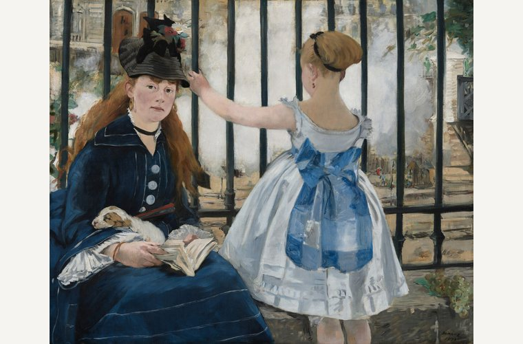</a></td>
<td width="50%" align="center"><a href="cases/rehearsal/generated.png">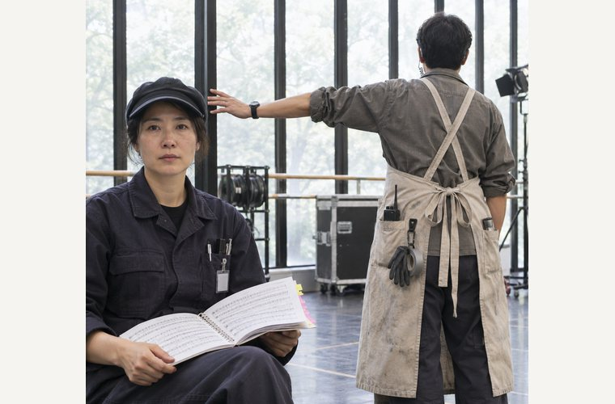</a></td>
</tr></tbody>
</table>

[下载左右拼接图](cases/rehearsal/comparison.jpg)

左人坐着正对镜头，右人背身伸臂；深色窗框接替了铁栅，膝上乐谱也回到了对应位置。 原图两人头顶接近，成图右人明显高于左人。原图向左上扬的手臂变得接近水平。

**中文正向 · 实际输入** · [TXT](cases/rehearsal/positive.zh.txt)

```text
略宽于正方形的横幅纪实彩照，在排练厅里近距离拍两个人。左前景坐着一位穿深色工作服的成年乐谱管理员，正脸朝向镜头，手里的乐谱摊在膝上，身体一直裁到左边和下边。右侧一名穿浅色长围裙的成年舞台技师背对镜头站立，后脑与左侧坐者的帽顶接近同一高度；左手臂向画面左方横伸，手指靠近坐者头旁的垂直框条。技师的背和围裙占右半幅，脚裁在下沿。等间距的深色竖向窗框贯穿后景，窗外明亮漫射光衬出两个人相反的朝向。
```

<details>
<summary>英文正向与中英负面提示词</summary>

**英文正向 · 译文** · [TXT](cases/rehearsal/positive.en.txt)

```text
A close documentary color photograph of two people in a rehearsal hall, in a landscape frame slightly wider than square. In the left foreground an adult music librarian in dark work clothes sits facing the camera, with sheet music open on their knees. The body extends beyond the left and bottom edges. On the right an adult stage technician in a long pale apron stands with their back to the camera. The top of the technician’s head and the seated person’s cap are at nearly the same height. The technician extends their left arm across the frame to the left, fingers near the vertical mullion beside the librarian’s head. The back and apron fill the right half, with the feet cropped at the lower edge. Evenly spaced dark vertical window frames span the background. Bright diffuse light from outside sets off the two opposing orientations.
```

**中文负面 · 可选** · [TXT](cases/rehearsal/negative.zh.txt)

```text
两人都看镜头，两人都背对镜头，人物左右互换，头顶高度相差很大，双臂垂下，横向窗框占主导
```

**英文负面 · 可选** · [TXT](cases/rehearsal/negative.en.txt)

```text
both subjects facing the camera, both subjects facing away, subjects swapping sides, large difference in head height, both arms hanging down, dominant horizontal window bars
```

</details>

原图出自 The Railway / Édouard Manet · 1873 · 美国国家美术馆。[作品来源](https://www.nga.gov/artworks/43624-railway) · [案例文件夹](cases/rehearsal)

<a name="landscapes"></a>

## 风景

### 雪峰下的蛇河

**整图复现**　检查河湾入口和转折位置、最高山峰，以及黑白影调。

<table>
<thead><tr><th>参考图</th><th>生成图</th></tr></thead>
<tbody><tr>
<td width="50%" align="center"><a href="cases/snake-river/reference.jpg">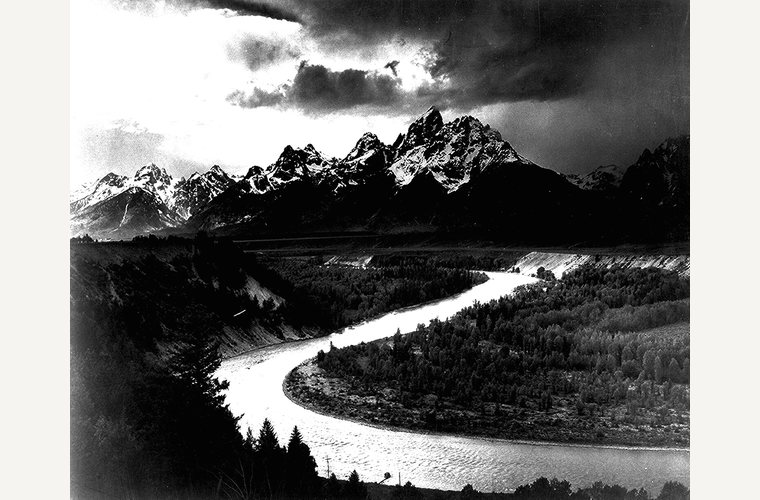</a></td>
<td width="50%" align="center"><a href="cases/snake-river/generated.png">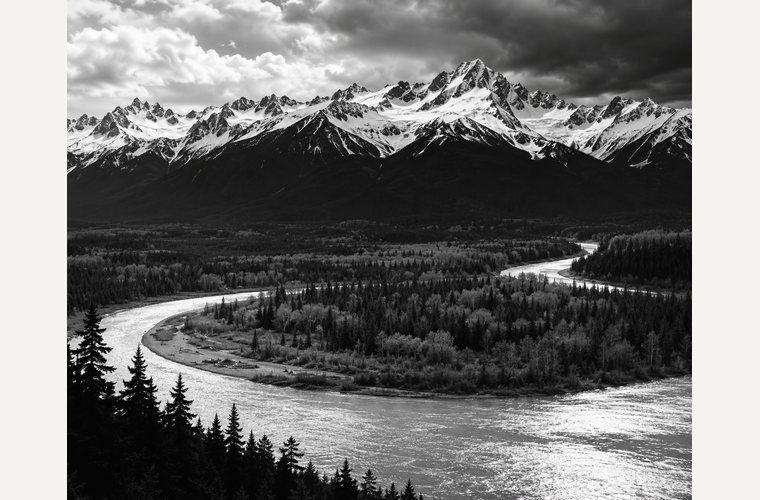</a></td>
</tr></tbody>
</table>

[下载左右拼接图](cases/snake-river/comparison.jpg)

成图保留了右下进入、向左回弯再向右收窄的明亮河道，以及左下树影和偏右的最高峰。 河湾转折更靠左，远山位置更高，天空变窄。高光散布到整排雪峰，原图由河水和左上亮天空形成的对比更强。

**中文正向 · 实际输入** · [TXT](cases/snake-river/positive.zh.txt)

```text
5:4横幅黑白风景摄影，从高处俯瞰林地间的河湾。明亮河水由右下边缘宽阔地进入，沿下方横向向左回弯，在画面左下三分之一处绕出一个大弧，再向右上收窄，消失在右侧中景林带。近处黑色针叶树剪影压住左下角。深黑山脚横贯中央，锯齿状覆雪山脊位于上半部，最高的山峰在中心偏右。上方云层左白右暗，局部雪面和水面接近纯白，保留林地的灰阶层次。
```

<details>
<summary>英文正向与中英负面提示词</summary>

**英文正向 · 译文** · [TXT](cases/snake-river/positive.en.txt)

```text
A 5:4 black-and-white landscape photograph from a high vantage point above a wooded bend in a river. A broad band of bright water enters at the lower right edge and sweeps left across the bottom, forming a wide bend near the lower left third. It narrows toward the upper right and disappears into the trees in the right middle distance. Dark conifer silhouettes anchor the lower left corner. Deep black mountain foothills span the center. A jagged snow-covered ridge occupies the upper half, with the tallest peak just right of center. The clouds are bright on the left and dark on the right. Parts of the snow and water approach pure white, while the forest retains a range of grays.
```

**中文负面 · 可选** · [TXT](cases/snake-river/negative.zh.txt)

```text
彩色调色，倒置的河湾，最高峰靠左，水面漆黑，林区暗部完全堵死
```

**英文负面 · 可选** · [TXT](cases/snake-river/negative.en.txt)

```text
color grading, reversed river bend, tallest peak on the left, pitch-black water, fully blocked forest shadows
```

</details>

原图出自 The Tetons and the Snake River / Ansel Adams / U.S. National Archives。[作品来源](https://catalog.archives.gov/id/519904) · [案例文件夹](cases/snake-river)

### 从睡莲池到砂岩峡谷

**参考构图**　把桥和水面换成石拱与干河床，检验高位横拱和近宽远窄的横带。

<table>
<thead><tr><th>参考图</th><th>生成图</th></tr></thead>
<tbody><tr>
<td width="50%" align="center"><a href="cases/sandstone-arch/reference.jpg">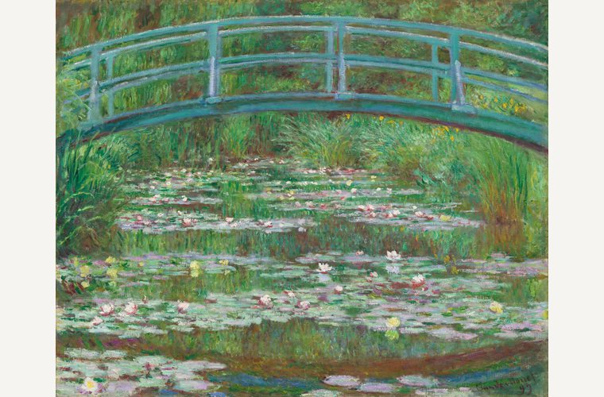</a></td>
<td width="50%" align="center"><a href="cases/sandstone-arch/generated.png">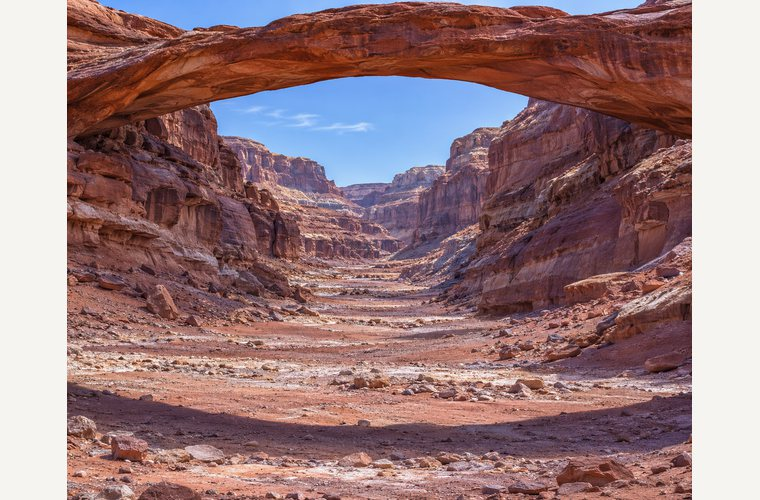</a></td>
</tr></tbody>
</table>

[下载左右拼接图](cases/sandstone-arch/comparison.jpg)

石拱横跨画面上部，两端伸出画外。浅色碎石横带随河床向远处变密，底边弧形阴影也出现了。 桥下原是连续的深绿植被和水面，石拱下增加了一大片蓝天。横拱位置相近，中部留白与视线落点随之改变。

**中文正向 · 实际输入** · [TXT](cases/sandstone-arch/positive.zh.txt)

```text
5:4横幅的真实沙漠峡谷照片。画面上四分之一是一道长而低的红砂岩天然石拱，中央略向上隆起，拱身左右都延伸到画外，顶缘接近画面上边。拱洞下面是层层后退的干涸河床，从下沿宽阔的近景收窄到中部，两侧陡起岩壁收住视线。浅色矿物沉积和碎石呈数道断续的横带，近处较宽，向远处逐渐变密；底部一道阴影呼应上方弧线。用沙黄、铁锈红和冷紫阴影表现岩石纹层。
```

<details>
<summary>英文正向与中英负面提示词</summary>

**英文正向 · 译文** · [TXT](cases/sandstone-arch/positive.en.txt)

```text
A realistic 5:4 landscape photograph of a desert canyon. A long, low natural arch of red sandstone crosses the upper quarter. It rises slightly in the middle, runs beyond both edges, and approaches the top border. Below the opening, a dry riverbed recedes in layers, broad in the immediate foreground and narrowing toward the center. Steep rock walls on either side channel the eye inward. Pale mineral deposits and gravel form interrupted horizontal bands, wider nearby and closer together in the distance. A curved shadow at the bottom echoes the arch above. Sandy yellow, iron red and cool purple shadows bring out the rock strata.
```

**中文负面 · 可选** · [TXT](cases/sandstone-arch/negative.zh.txt)

```text
木桥，栏杆，睡莲，池水，画面中央的大圆拱，大片无细节蓝天
```

**英文负面 · 可选** · [TXT](cases/sandstone-arch/negative.en.txt)

```text
wooden footbridge, railings, water lilies, pond water, large round arch centered in the frame, broad featureless blue sky
```

</details>

原图出自 The Japanese Footbridge / Claude Monet / National Gallery of Art。[作品来源](https://www.nga.gov/artworks/74796-japanese-footbridge) · [案例文件夹](cases/sandstone-arch)

<a name="anime"></a>

## 动漫

### 蓝发双马尾立绘

**整图复现**　检查拼图发饰、围裙和手脚姿态，同时验证导出文件的透明通道。

<table>
<thead><tr><th>参考图</th><th>生成图</th></tr></thead>
<tbody><tr>
<td width="50%" align="center"><a href="cases/blue-twin-tails/reference.png">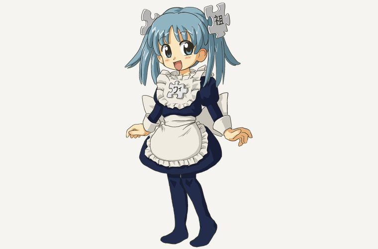</a></td>
<td width="50%" align="center"><a href="cases/blue-twin-tails/generated.png">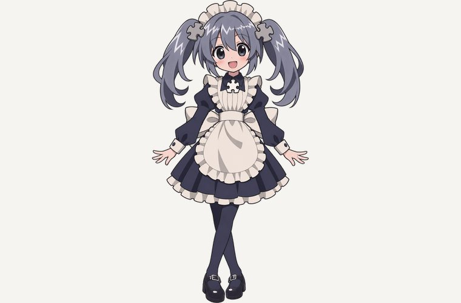</a></td>
</tr></tbody>
</table>

[下载左右拼接图](cases/blue-twin-tails/comparison.jpg)

双马尾、两侧拼图夹、藏青洋装、米白围裙及完整站姿可辨。生成 PNG 确有从 0 到 255 的透明通道。 发色由灰蓝偏向灰紫，马尾变卷，发夹缩小。模型补出头顶褶边发箍和有鞋扣的鞋，原图的侧转感也减弱。另启用透明背景输出。

**中文正向 · 实际输入** · [TXT](cases/blue-twin-tails/positive.zh.txt)

```text
约1:1.9竖幅的透明底动漫全身立绘。单个圆头大眼的卡通角色居中，从头顶装饰到鞋底完整可见；灰蓝色双马尾向左右张开，银白尖锯齿状发丝高光，两侧头发各夹一块灰色拼图形发饰。大黑眼睛带白色高光，双颊淡红，张嘴微笑。藏青色长袖洋装、米白蓬褶胸围和圆弧形围裙，胸前一块白色拼图徽章，腰后是大白蝴蝶结。双臂斜向下、手指向两边摊开，深蓝色双腿在小腿处轻轻交叠。细而有轻重的炭灰描边，大块平涂加单层硬边阴影。
```

<details>
<summary>英文正向与中英负面提示词</summary>

**英文正向 · 译文** · [TXT](cases/blue-twin-tails/positive.en.txt)

```text
A full-length anime character illustration in a roughly 1:1.9 portrait frame on a transparent background. Center one round-headed, wide-eyed cartoon character with everything visible from the hair ornaments to the soles. Gray-blue twin ponytails spread to either side, with silvery white zigzag highlights and one gray puzzle-piece clip on each side. Large black eyes have white highlights. The cheeks are lightly flushed and the mouth opens in a smile. A navy long-sleeved dress has an ivory ruffled bib and rounded apron, a white puzzle-piece badge on the chest and a large white bow behind the waist. Both arms angle down with the fingers spread out to the sides. The dark blue legs cross lightly at the calves. Fine charcoal-gray outlines vary in weight, enclosing flat areas of color with a single layer of hard-edged shading.
```

**中文负面 · 可选** · [TXT](cases/blue-twin-tails/negative.zh.txt)

```text
不透明背景，脚部裁切，卷曲紫色双马尾，褶边发箍，带鞋扣的皮鞋，缺少拼图夹
```

**英文负面 · 可选** · [TXT](cases/blue-twin-tails/negative.en.txt)

```text
opaque background, feet cropped, curly purple twin ponytails, ruffled headband, buckled leather shoes, missing puzzle-piece clips
```

</details>

原图出自 Wikipe-tan full length / Kasuga / Wikimedia Commons。[作品来源](https://commons.wikimedia.org/wiki/File:Wikipe-tan_full_length.png) · [案例文件夹](cases/blue-twin-tails) · [参考图与本例改编图像的 CC BY-SA 3.0 许可](https://creativecommons.org/licenses/by-sa/3.0/)

### 从校园漫画到钟表铺

**参考画风**　换角色和情节，检验黑白用墨、三格叙事和两处中文文字。

<table>
<thead><tr><th>参考图</th><th>生成图</th></tr></thead>
<tbody><tr>
<td width="50%" align="center"><a href="cases/clockmakers-manga/reference.png">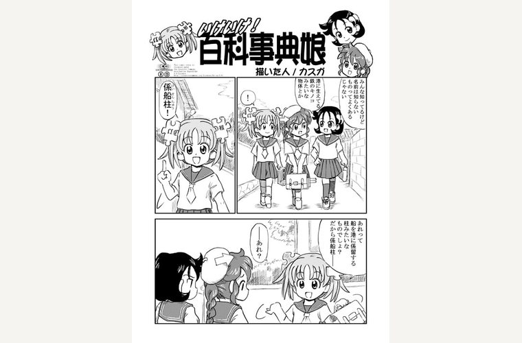</a></td>
<td width="50%" align="center"><a href="cases/clockmakers-manga/generated.png">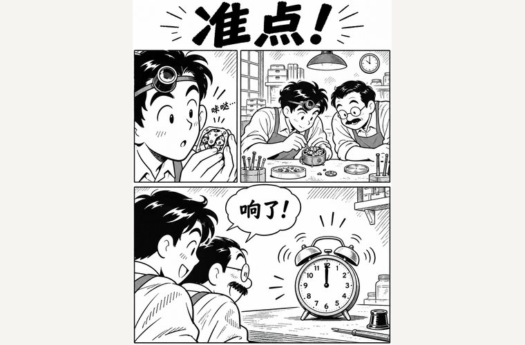</a></td>
</tr></tbody>
</table>

[下载左右拼接图](cases/clockmakers-manga/comparison.jpg)

上两格、下通栏及右修理、左反应的叙事顺序正确。标题“准点！”和对白“响了！”均能读出，人物和事件已换成修钟。 原页的细线、宽白边和人物留白变成了粗墨、大特写与窄页边。左上另有“咔哒…”音效，来自提示词里的听觉描述。

**中文正向 · 实际输入** · [TXT](cases/clockmakers-manga/positive.zh.txt)

```text
3:4竖幅的黑白日式短篇漫画页，主题是两位成年钟表匠修好一只闹钟。页首用夸张粗黑手绘字写“准点！”。上排两格、下排一格通栏：右上中景画两位工匠俯身在工作台边，左上特写画一人听见机芯咔哒响、眼睛睁大；下格以前景左侧的两个人物肩背框住右侧振铃的闹钟。对白泡内只写“响了！”。用轻快的黑墨轮廓、简化圆润的五官、实黑头发与白色留亮，袖褶和背景用稀疏短排线，少量平灰区分前后，纸白占大部分。
```

<details>
<summary>英文正向与中英负面提示词</summary>

**英文正向 · 译文** · [TXT](cases/clockmakers-manga/positive.en.txt)

```text
A 3:4 portrait page from a short black-and-white Japanese-style manga about two adult watchmakers repairing an alarm clock. Use exaggerated, bold, hand-drawn black lettering for the title “准点！” at the top. Place two panels above one full-width bottom panel. In the upper right, show both watchmakers in a medium shot leaning over the bench. In the upper left, show a close-up of one widening their eyes on hearing the movement click. In the lower panel, the shoulders and backs of the two figures in the left foreground frame the ringing alarm clock on the right. The speech bubble contains only “响了！”. Use lively black ink contours, simple rounded facial features, solid black hair with white highlights, sparse short hatching on sleeves and background, and touches of flat gray to separate depth planes. Leave most of the paper white.
```

**中文负面 · 可选** · [TXT](cases/clockmakers-manga/negative.zh.txt)

```text
彩色页面，四格等分，底部通栏被拆开，英文替代中文，重复对白泡，校服人物
```

**英文负面 · 可选** · [TXT](cases/clockmakers-manga/negative.en.txt)

```text
color page, four equal panels, bottom panel split in two, English replacing the Chinese text, duplicate speech balloons, characters in school uniforms
```

</details>

原图出自 Wikipe-tan manga page1 / Kasuga / Wikimedia Commons。[作品来源](https://commons.wikimedia.org/wiki/File:Wikipe-tan_manga_page1.jpg) · [案例文件夹](cases/clockmakers-manga) · [参考图与本例改编图像的 CC BY-SA 3.0 许可](https://creativecommons.org/licenses/by-sa/3.0/)

<a name="still-life"></a>

## 静物

### 蛋糕、柠檬与玻璃杯

**整图复现**　检查物体排列、柠檬与蛋糕的遮挡，以及吸管与画框的交点。

<table>
<thead><tr><th>参考图</th><th>生成图</th></tr></thead>
<tbody><tr>
<td width="50%" align="center"><a href="cases/cake-and-lemon/reference.jpg">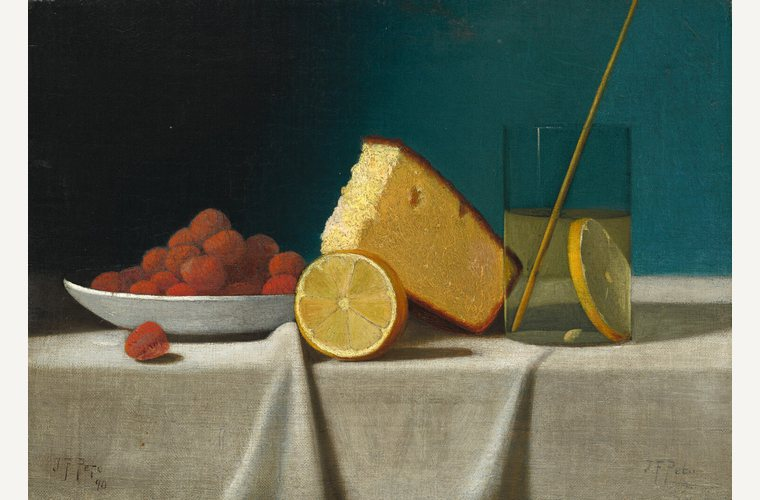</a></td>
<td width="50%" align="center"><a href="cases/cake-and-lemon/generated.png">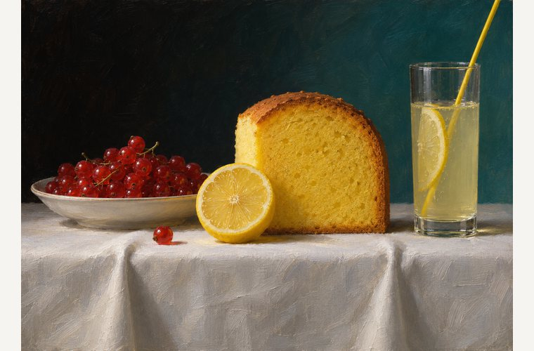</a></td>
</tr></tbody>
</table>

[下载左右拼接图](cases/cake-and-lemon/comparison.jpg)

左盘、中间蛋糕、右杯的顺序准确。柠檬切面遮住蛋糕左下角，前景有一颗散果，黄色吸管从顶边出画。 原图蛋糕向右倾斜，成图改成了平底直立的厚片。只写“小红浆果”也留下歧义，模型画出了成串、表皮发亮的小果。

**中文正向 · 实际输入** · [TXT](cases/cake-and-lemon/positive.zh.txt)

```text
约7:5横幅的写实静物油画，白色桌布的前沿横过下三分之一，两道垂直褶皱落向底边。自左到右依次是一只盛满小红浆果的浅白盘、一块拱形黄蛋糕、一只细直透明玻璃杯。蛋糕直立，朝左的窄切面迎光，金黄宽面朝向观者，棕色外皮勾边；半个柠檬在它左前方，圆形切面正对观者，遮住蛋糕的左下角。左前另有一颗散落的红莓。杯中有淡黄色饮料和一片竖立的柠檬，一根细长黄吸管斜向右上，伸出顶边。深色背景由左边近黑过渡到右边蓝绿。
```

<details>
<summary>英文正向与中英负面提示词</summary>

**英文正向 · 译文** · [TXT](cases/cake-and-lemon/positive.en.txt)

```text
A realistic still-life oil painting in a roughly 7:5 landscape frame. The front edge of a white tablecloth crosses the lower third, with two vertical folds dropping toward the bottom. From left to right are a shallow white plate heaped with small red berries, an arched slice of yellow cake, and a slim straight-sided clear glass. The cake stands upright with its narrow left cut face catching the light, its broad golden face toward the viewer and its brown crust tracing the edge. A lemon half in front on the left presents its round cut face directly to the viewer, obscuring the cake’s lower left corner. A single red berry lies loose at front left. The glass contains a pale yellow drink and an upright lemon slice. A long thin yellow straw angles toward the upper right and exits the top edge. The dark background grades from near-black on the left to teal on the right.
```

**中文负面 · 可选** · [TXT](cases/cake-and-lemon/negative.zh.txt)

```text
柠檬在蛋糕后方，玻璃杯在左侧，吸管朝左倾斜，圆形整蛋糕，多余的盘碟
```

**英文负面 · 可选** · [TXT](cases/cake-and-lemon/negative.en.txt)

```text
lemon behind the cake, drinking glass on the left, straw leaning left, whole round cake, extra plates
```

</details>

原图出自 Still Life with Cake, Lemon, Strawberries, and Glass / John Frederick Peto / National Gallery of Art。[作品来源](https://www.nga.gov/artworks/164947-still-life-cake-lemon-strawberries-and-glass) · [案例文件夹](cases/cake-and-lemon)

### 从白玫瑰到海贝

**参考画风**　把花瓣上的弧形厚笔触转移到贝壳上，检验用色、轮廓与背景笔势。

<table>
<thead><tr><th>参考图</th><th>生成图</th></tr></thead>
<tbody><tr>
<td width="50%" align="center"><a href="cases/seashells/reference.jpg">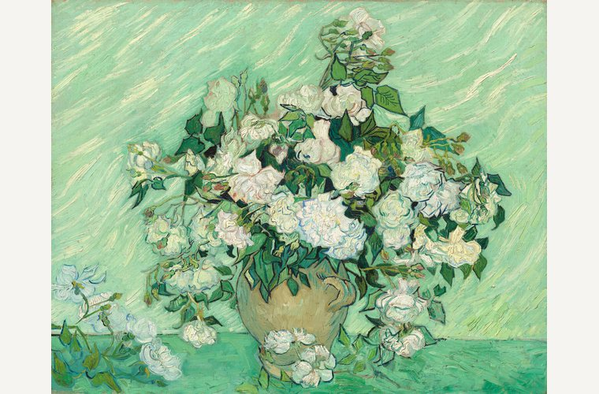</a></td>
<td width="50%" align="center"><a href="cases/seashells/generated.png">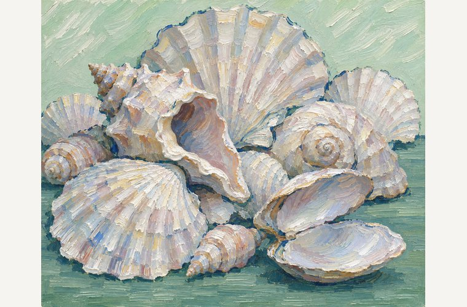</a></td>
</tr></tbody>
</table>

[下载左右拼接图](cases/seashells/comparison.jpg)

奶白、灰蓝和淡粉用在贝壳亮面，颜料形成凸起笔脊；背景的薄荷绿斜笔与桌面的横笔都能辨认。没有带入花瓶或玫瑰。 原画在白花之间穿插大块深绿和深色勾线，成图的壳间暗隙较窄，色块分隔变弱；壳面的方块状笔触也更整齐。

**中文正向 · 实际输入** · [TXT](cases/seashells/positive.zh.txt)

```text
画一幅约5:4横幅的海贝静物油画：多枚乳白色扇贝、海螺和一枚翻开的蛤壳交叠在青绿色桌面上。用短而隆起的弧形笔触循贝壳纹路转折，奶白、浅蓝、淡黄与灰粉在亮面交错；壳口和重叠处以断续深蓝绿外轮廓拉开。背景是浅薄荷绿，用较长的奶白斜笔轻轻带过，桌面用较平的绿笔横铺。将细节集中在壳脊、螺旋和壳口的暗面。
```

<details>
<summary>英文正向与中英负面提示词</summary>

**英文正向 · 译文** · [TXT](cases/seashells/positive.en.txt)

```text
Paint a roughly 5:4 landscape still life in oils: several ivory scallop shells, spiral sea shells and an open clam shell overlapping on a blue-green tabletop. Lay short, raised arcs of paint along the shell ribs, alternating creamy white, pale blue, soft yellow and gray pink on the lit surfaces. Use broken dark blue-green outlines to distinguish shell openings and overlapping forms. On a pale mint background, lay longer diagonal strokes of creamy white with a light touch. Cover the tabletop in flatter horizontal green strokes. Concentrate detail on the ridges, spirals and dark interiors of the shells.
```

**中文负面 · 可选** · [TXT](cases/seashells/negative.zh.txt)

```text
花瓶，玫瑰，连续粗黑描边，光滑塑料贝壳，喷枪渐变背景
```

**英文负面 · 可选** · [TXT](cases/seashells/negative.en.txt)

```text
flower vase, roses, continuous heavy black outlines, smooth plastic shells, airbrushed gradient background
```

</details>

原图出自 Roses / Vincent van Gogh / National Gallery of Art。[作品来源](https://www.nga.gov/artworks/72328-roses) · [案例文件夹](cases/seashells)

### 从甜瓜到旧皮鞋

**参考画风**　换成一双旧鞋，保留亮部厚涂、薄擦背景和冷暖用色。

<table>
<thead><tr><th>参考图</th><th>生成图</th></tr></thead>
<tbody><tr>
<td width="50%" align="center"><a href="cases/leather-shoes/reference.jpg">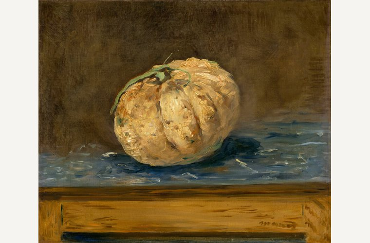</a></td>
<td width="50%" align="center"><a href="cases/leather-shoes/generated.png">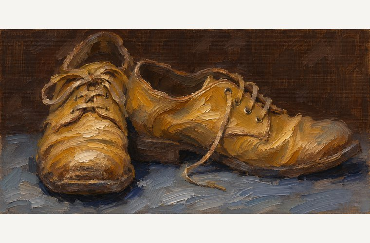</a></td>
</tr></tbody>
</table>

[下载左右拼接图](cases/leather-shoes/comparison.jpg)

鞋面能看到堆起的赭黄笔触，承托面仍用蓝灰横笔。鞋的造型完整，画中没有带入甜瓜。 背景刷痕更重，鞋面高光比原图更暗。原画宽高约 1.20，生成图达 2.00，横向拉得比提示词要求更开。

**中文正向 · 实际输入** · [TXT](cases/leather-shoes/positive.zh.txt)

```text
画一双随意靠在一起的旧芥黄色系带皮鞋，一只露出鞋头，一只侧向露出鞋带。略宽的横幅布面油画。用短促弯曲、方向清楚的厚油彩塑造鞋面，每道奶黄和赭金色亮笔都留有堆起的脊线，凹处以橄榄褐和冷灰衔接。深棕背景薄擦，留出隐约可见的画布经纬；鞋底附近的蓝灰色承托面用粗宽横笔带过，局部深蓝阴影压住鞋底。细节集中在鞋面亮部，边缘有实有虚。
```

<details>
<summary>英文正向与中英负面提示词</summary>

**英文正向 · 译文** · [TXT](cases/leather-shoes/positive.en.txt)

```text
Paint a pair of worn mustard-yellow lace-up leather shoes leaning loosely against each other. One presents its toe and the other turns sideways to show the laces. Use a slightly wider-than-tall canvas in oils. Model the leather with short, curved strokes of thick paint, each creamy yellow or golden ocher highlight leaving a raised ridge. Olive brown and cool gray meet in the recesses. Scumble the dark brown background thinly enough to reveal a hint of canvas weave. Lay in the blue-gray surface beneath the soles with broad horizontal strokes. Localized deep blue shadows anchor the shoes. Concentrate detail in the highlights on the leather, alternating defined and softened edges.
```

**中文负面 · 可选** · [TXT](cases/leather-shoes/negative.zh.txt)

```text
甜瓜，水果，光滑数字渐变，镜面鞋面，超宽全景画幅
```

**英文负面 · 可选** · [TXT](cases/leather-shoes/negative.en.txt)

```text
melon, fruit, smooth digital gradients, mirror-polished leather, ultrawide panoramic framing
```

</details>

原图出自 The Melon / Édouard Manet · 约 1880 · 美国国家美术馆。[作品来源](https://www.nga.gov/artworks/164939-melon) · [案例文件夹](cases/leather-shoes)

### 从咖啡馆到实验室

**参考构图**　把杯碟和勺的空间关系映射为培养皿、托盘和镊子。

<table>
<thead><tr><th>参考图</th><th>生成图</th></tr></thead>
<tbody><tr>
<td width="50%" align="center"><a href="cases/petri-dish/reference.png"></a></td>
<td width="50%" align="center"><a href="cases/petri-dish/generated.png">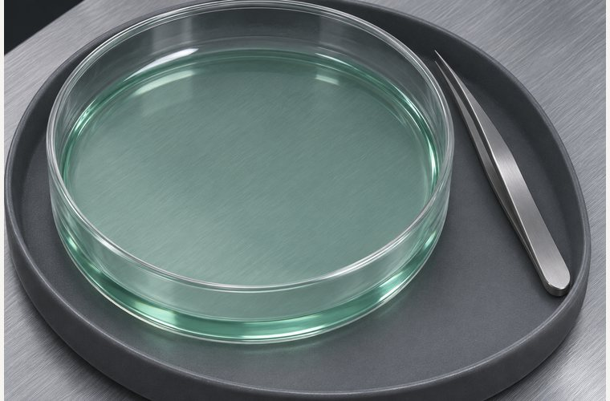</a></td>
</tr></tbody>
</table>

[下载左右拼接图](cases/petri-dish/comparison.jpg)

内外椭圆、右侧细长工具、左上暗角与斜纹台面都出现。材质和配色已切换。 托盘几乎铺满画幅，底部越界；镊尖朝左上，原图匙柄朝右上，工具斜向翻转。

**中文正向 · 实际输入** · [TXT](cases/petri-dish/positive.zh.txt)

```text
3:2 横幅，冷灰色调的写实实验室静物，从上方斜俯视。一个厚沿透明培养皿放在扁圆的深灰色样品托盘内，层叠椭圆占画面中央偏左；托盘下沿几乎碰到底边，培养皿上沿接近顶边。皿中有浅薄的青绿色液体，右侧托盘上贴着一把闭合的银色镊子，圆尾朝右下，尖端沿皿外缘指向右上。灰色拉丝金属台面的纹路由左下斜向右上，画面左上角露出台面以外的一小块深色区域。
```

<details>
<summary>英文正向与中英负面提示词</summary>

**英文正向 · 译文** · [TXT](cases/petri-dish/positive.en.txt)

```text
A realistic laboratory still life in a cool gray palette, shot obliquely from above in a 3:2 landscape frame. A thick-rimmed transparent Petri dish sits inside a flattened oval dark gray sample tray. The nested ellipses are slightly left of center. The tray nearly touches the bottom edge and the dish rim approaches the top. A shallow layer of blue-green liquid fills the dish. Closed silver tweezers lie along the right side of the tray, rounded end at lower right and tips pointing toward the upper right along the outer rim of the dish. Brushed gray metal grain runs diagonally from lower left to upper right. A small dark area beyond the worktop shows at the top left.
```

**中文负面 · 可选** · [TXT](cases/petri-dish/negative.zh.txt)

```text
木桌，咖啡杯，瓷碟，不透明培养皿，镊子尖端朝左上，托盘底部出画
```

**英文负面 · 可选** · [TXT](cases/petri-dish/negative.en.txt)

```text
wooden table, coffee cup, porcelain saucer, opaque Petri dish, tweezer tips pointing upper left, bottom of tray cropped
```

</details>

原图出自 浓缩咖啡 / Rachel Michetti · Pikolo Espresso Bar / scikit-image。[作品来源](https://scikit-image.org/docs/0.22.x/api/skimage.data.html#skimage.data.coffee) · [案例文件夹](cases/petri-dish)

<a name="posters"></a>

## 海报

### 蒙大拿旅行海报

**整图复现**　保留三行标题、山形、松林和左下方的骑手。

<table>
<thead><tr><th>参考图</th><th>生成图</th></tr></thead>
<tbody><tr>
<td width="50%" align="center"><a href="cases/montana-poster/reference.jpg"></a></td>
<td width="50%" align="center"><a href="cases/montana-poster/generated.png">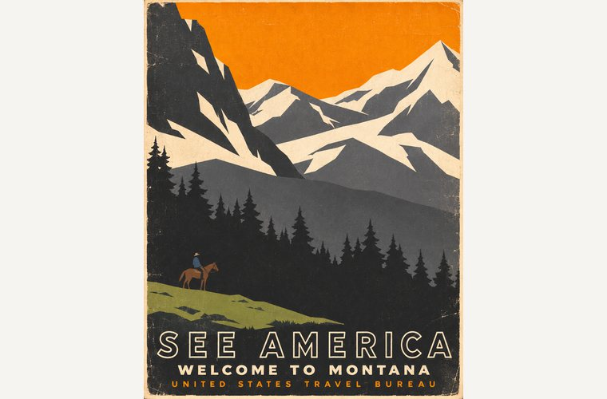</a></td>
</tr></tbody>
</table>

[下载左右拼接图](cases/montana-poster/comparison.jpg)

三行英文逐字吻合，空心大标题、左下骑手与右上雪山都出现了。 天空橙色面积扩大，山面从大色块变成多条碎雪带。第二行字体更粗，纸面磨损也更重。

**中文正向 · 实际输入** · [TXT](cases/montana-poster/positive.zh.txt)

```text
约4:5竖幅的旧丝网印刷旅行海报，细米白边框。橙黄色天空下是大片几何雪山，山体用炭灰与暖白硬边斜面拼接；左侧深色山脊高耸出顶边，右侧白色三角山尖在右上。深灰山坡横切中部。下半部是近黑的锯齿松林剪影，左下绿色坡地上有一名很小的蓝衣骑手，骑棕马面向右。底部横跨全宽排列三行英文，第一行米白空心宽字距大写“SEE AMERICA”，第二行较小米白实心字“WELCOME TO MONTANA”，第三行最小橙黄字“UNITED STATES TRAVEL BUREAU”。平涂色块，旧纸轻微磨损。
```

<details>
<summary>英文正向与中英负面提示词</summary>

**英文正向 · 译文** · [TXT](cases/montana-poster/positive.en.txt)

```text
A vintage screen-printed travel poster, approximately 4:5 portrait, with a narrow ivory border. Broad geometric snow-covered mountains sit beneath an orange-yellow sky. Hard-edged diagonal planes of charcoal and warm white define the mountains. A dark ridge on the left rises beyond the top edge. A white triangular summit sits at upper right. A dark gray slope cuts across the middle. Near-black jagged pine silhouettes fill the lower half. At lower left, a tiny rider dressed in blue faces right on a brown horse on a green slope. Three English lines span the bottom: large, widely spaced ivory outline capitals reading “SEE AMERICA”, smaller solid ivory letters reading “WELCOME TO MONTANA”, and the smallest line in yellow-orange reading “UNITED STATES TRAVEL BUREAU”. Flat areas of ink on lightly worn paper.
```

**中文负面 · 可选** · [TXT](cases/montana-poster/negative.zh.txt)

```text
写实风景照片，细碎雪带，骑手居中，标题拼错，文字行序颠倒，重度纸面磨损
```

**英文负面 · 可选** · [TXT](cases/montana-poster/negative.en.txt)

```text
photographic landscape, fragmented bands of snow, centered rider, misspelled title, text lines in reversed order, heavy paper distress
```

</details>

原图出自 See America. Welcome to Montana / 美国国会图书馆 · 馆藏号 96503136。[作品来源](https://www.loc.gov/pictures/item/96503136/) · [案例文件夹](cases/montana-poster)

### 从雪山到末班电车

**参考画风**　换成终点站电车，沿用套色版画的硬边与底部标题。

<table>
<thead><tr><th>参考图</th><th>生成图</th></tr></thead>
<tbody><tr>
<td width="50%" align="center"><a href="cases/last-tram/reference.jpg">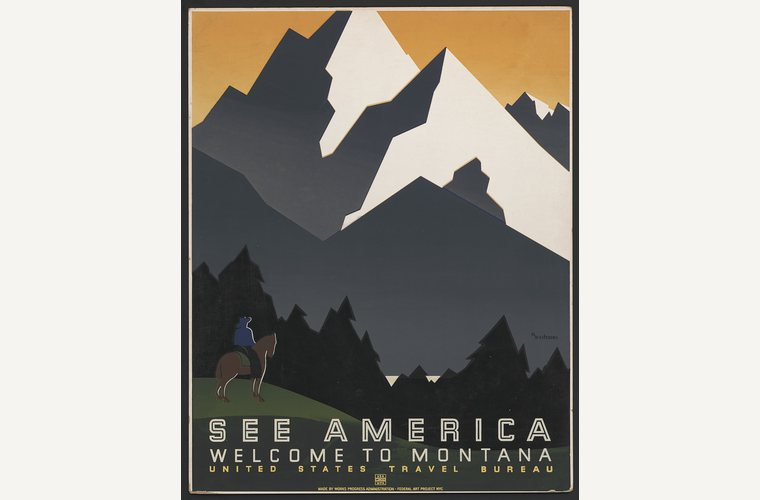</a></td>
<td width="50%" align="center"><a href="cases/last-tram/generated.png">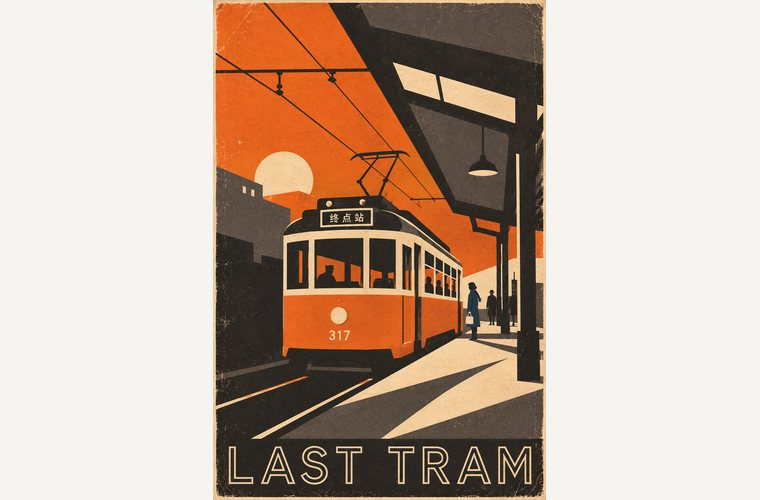</a></td>
</tr></tbody>
</table>

[下载左右拼接图](cases/last-tram/comparison.jpg)

橙、纸白与炭黑分出车身和站棚，底部空心字 LAST TRAM 准确。没有带入雪山或骑手。 橙色更艳，电线、车窗和站台细节更多，原画的大色块更概括。

**中文正向 · 实际输入** · [TXT](cases/last-tram/positive.zh.txt)

```text
设计一张“末班电车”主题的竖幅丝网版画海报。主视觉是一辆驶入终点站的老电车，架空电线与站棚切过上方。把车身、站棚、天空和站台概括成几块大的硬边多边形，斜线干脆，远近靠色块重叠拉开；用暖橙、纸白、炭灰和近黑平涂，只在小人物身上点一点暗蓝。保留轻微纸张磨痕、四周窄纸边。底部用米白色双线空心宽间距大写字排一行“LAST TRAM”。
```

<details>
<summary>英文正向与中英负面提示词</summary>

**英文正向 · 译文** · [TXT](cases/last-tram/positive.en.txt)

```text
Design a portrait-format screen-printed poster about the last tram. An old tram pulls into the terminus beneath overhead wires and a station canopy. Simplify the vehicle, canopy, sky and platform into large hard-edged polygons. Use decisive diagonals and overlapping flat shapes to separate near and far planes. Print in warm orange, paper white, charcoal and near-black, with a small touch of dark blue on the tiny figures. Keep mild paper wear and a narrow paper border. Across the bottom, set “LAST TRAM” on one line in widely spaced ivory double-outline capitals.
```

**中文负面 · 可选** · [TXT](cases/last-tram/negative.zh.txt)

```text
雪山，骑手，写实摄影，渐变天空，密集细碎的装饰线，标题换行
```

**英文负面 · 可选** · [TXT](cases/last-tram/negative.en.txt)

```text
snowy peaks, horseback rider, photorealism, gradient sky, dense decorative linework, title split across lines
```

</details>

原图出自 See America. Welcome to Montana / 美国国会图书馆 · 馆藏号 96503136。[作品来源](https://www.loc.gov/pictures/item/96503136/) · [案例文件夹](cases/last-tram)

<a name="coffee-study"></a>

## 咖啡杯修词对照

原词和修订词各生成两次。原词两张的碟底均被裁切。补写杯碟占比和边距后，两张都露出了完整碟边。

| 原词第一次 | 原词第二次 | 修订词第一次 | 修订词第二次 |
|:---:|:---:|:---:|:---:|
| [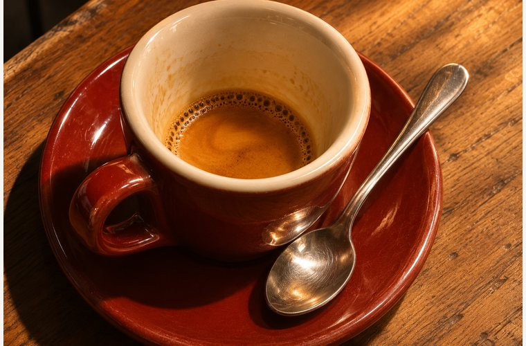](cases/coffee-original-1/generated.png) | [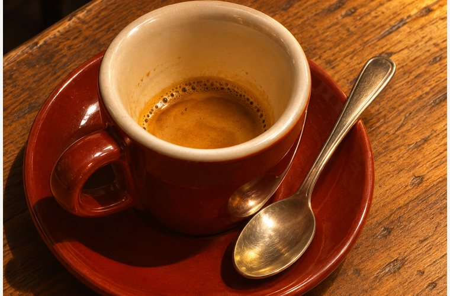](cases/coffee-original-2/generated.png) | [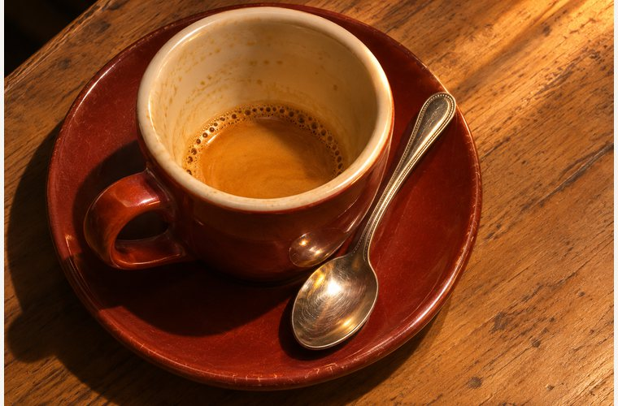](cases/coffee-revised-1/generated.png) | [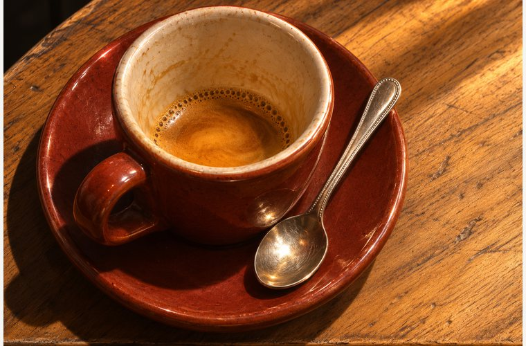](cases/coffee-revised-2/generated.png) |

<details>
<summary>咖啡杯 · 原词第一次 · 查看对比图与提示词</summary>

### 咖啡杯 · 原词第一次

**整图复现**　从照片还原杯、碟与匙的位置，同时保住桌面的留白。

<table>
<thead><tr><th>参考图</th><th>生成图</th></tr></thead>
<tbody><tr>
<td width="50%" align="center"><a href="cases/coffee-original-1/reference.png"></a></td>
<td width="50%" align="center"><a href="cases/coffee-original-1/generated.png"></a></td>
</tr></tbody>
</table>

[下载左右拼接图](cases/coffee-original-1/comparison.jpg)

杯柄朝左下，匙头落在右下，内外瓷色和木纹方向都对。 杯碟放得过大，碟底和杯沿贴边或被裁。匙柄也比原图更斜，光色偏橙。

**中文正向 · 实际输入** · [TXT](cases/coffee-original-1/positive.zh.txt)

```text
3:2 横幅的暖色咖啡馆实拍。一只红棕色厚瓷小杯连同同色圆碟占满画面中央略偏左的位置，从上方向下斜看。奶白色杯口靠近上边，杯内只剩浅浅一层金棕浓缩咖啡和一圈细泡；杯柄朝左下，银色小匙搭在碟子右侧，匙头在右下、柄向右上贴着杯身。红碟几乎碰到底边。蜂蜜色旧木桌的木纹从左下走向右上，左上角露出桌缘外的一小块暗色。斜射暖光照亮杯沿与金属，杯碟左下有深阴影。
```

<details>
<summary>英文正向与中英负面提示词</summary>

**英文正向 · 译文** · [TXT](cases/coffee-original-1/positive.en.txt)

```text
A warm-toned 3:2 landscape photograph in a café. Viewed obliquely from above, a thick reddish-brown porcelain demitasse and matching round saucer fill the frame just left of center. The creamy white rim sits near the top edge. Only a shallow layer of golden-brown espresso and a ring of fine bubbles remain. The handle points down and left. A silver teaspoon rests on the right of the saucer, its bowl at the lower right and its handle pointing up and right alongside the cup. The red saucer nearly touches the bottom edge. The grain of the old honey-colored wooden table runs from lower left to upper right. A small dark wedge beyond the table edge shows at the upper left. Warm raking light catches the rim and metal, with deep shadows below and to the left of the cup and saucer.
```

**中文负面 · 可选** · [TXT](cases/coffee-original-1/negative.zh.txt)

```text
正俯视，右侧杯柄，匙头朝上，满杯咖啡，牛奶拉花，碟底出画
```

**英文负面 · 可选** · [TXT](cases/coffee-original-1/negative.en.txt)

```text
direct overhead view, handle on the right, spoon bowl pointing upward, full cup, milk foam art, saucer cropped at the bottom
```

</details>

原图出自 浓缩咖啡 / Rachel Michetti · Pikolo Espresso Bar / scikit-image。[作品来源](https://scikit-image.org/docs/0.22.x/api/skimage.data.html#skimage.data.coffee) · [案例文件夹](cases/coffee-original-1)

</details>

<details>
<summary>咖啡杯 · 原词第二次 · 查看对比图与提示词</summary>

### 咖啡杯 · 原词第二次

**整图复现**　从照片还原杯、碟与匙的位置，同时保住桌面的留白。

<table>
<thead><tr><th>参考图</th><th>生成图</th></tr></thead>
<tbody><tr>
<td width="50%" align="center"><a href="cases/coffee-original-2/reference.png"></a></td>
<td width="50%" align="center"><a href="cases/coffee-original-2/generated.png"></a></td>
</tr></tbody>
</table>

[下载左右拼接图](cases/coffee-original-2/comparison.jpg)

杯柄和匙头方向沿用了首张的布局。 红碟宽约占画宽的 79%，底边超出画幅。

**中文正向 · 实际输入** · [TXT](cases/coffee-original-2/positive.zh.txt)

```text
3:2 横幅的暖色咖啡馆实拍。一只红棕色厚瓷小杯连同同色圆碟占满画面中央略偏左的位置，从上方向下斜看。奶白色杯口靠近上边，杯内只剩浅浅一层金棕浓缩咖啡和一圈细泡；杯柄朝左下，银色小匙搭在碟子右侧，匙头在右下、柄向右上贴着杯身。红碟几乎碰到底边。蜂蜜色旧木桌的木纹从左下走向右上，左上角露出桌缘外的一小块暗色。斜射暖光照亮杯沿与金属，杯碟左下有深阴影。
```

<details>
<summary>英文正向与中英负面提示词</summary>

**英文正向 · 译文** · [TXT](cases/coffee-original-2/positive.en.txt)

```text
A warm-toned 3:2 landscape photograph in a café. Viewed obliquely from above, a thick reddish-brown porcelain demitasse and matching round saucer fill the frame just left of center. The creamy white rim sits near the top edge. Only a shallow layer of golden-brown espresso and a ring of fine bubbles remain. The handle points down and left. A silver teaspoon rests on the right of the saucer, its bowl at the lower right and its handle pointing up and right alongside the cup. The red saucer nearly touches the bottom edge. The grain of the old honey-colored wooden table runs from lower left to upper right. A small dark wedge beyond the table edge shows at the upper left. Warm raking light catches the rim and metal, with deep shadows below and to the left of the cup and saucer.
```

**中文负面 · 可选** · [TXT](cases/coffee-original-2/negative.zh.txt)

```text
正俯视，右侧杯柄，匙头朝上，满杯咖啡，牛奶拉花，碟底出画
```

**英文负面 · 可选** · [TXT](cases/coffee-original-2/negative.en.txt)

```text
direct overhead view, handle on the right, spoon bowl pointing upward, full cup, milk foam art, saucer cropped at the bottom
```

</details>

原图出自 浓缩咖啡 / Rachel Michetti · Pikolo Espresso Bar / scikit-image。[作品来源](https://scikit-image.org/docs/0.22.x/api/skimage.data.html#skimage.data.coffee) · [案例文件夹](cases/coffee-original-2)

</details>

<details>
<summary>咖啡杯 · 修订词第一次 · 查看对比图与提示词</summary>

### 咖啡杯 · 修订词第一次

**整图复现**　从照片还原杯、碟与匙的位置，同时保住桌面的留白。

<table>
<thead><tr><th>参考图</th><th>生成图</th></tr></thead>
<tbody><tr>
<td width="50%" align="center"><a href="cases/coffee-revised-1/reference.png"></a></td>
<td width="50%" align="center"><a href="cases/coffee-revised-1/generated.png"></a></td>
</tr></tbody>
</table>

[下载左右拼接图](cases/coffee-revised-1/comparison.jpg)

补写占比和边距后，四周碟边可见。 碟子仍稍宽于原图，杯壁有更明显的咖啡痕。

**中文正向 · 实际输入** · [TXT](cases/coffee-revised-1/positive.zh.txt)

```text
3:2 横幅的暖色咖啡馆实拍。一只红棕色厚瓷小杯连同同色圆碟完整落在画面中央略偏左的位置，从上方向下斜看。杯口横向直径约为画宽的五分之二，上沿距顶边约二十分之一画高，杯内只剩浅浅一层金棕浓缩咖啡和一圈细泡；杯柄朝左下，银色小匙搭在碟子右侧，匙头在右下、柄向右上贴着杯身。红碟宽约占全画宽的三分之二，四边完整可见，底边留一线木桌，右侧露出约五分之一画宽的桌面。蜂蜜色旧木桌的木纹从左下走向右上，左上角露出桌缘外的一小块暗色。斜射暖光照亮杯沿与金属，杯碟左下有深阴影。
```

<details>
<summary>英文正向与中英负面提示词</summary>

**英文正向 · 译文** · [TXT](cases/coffee-revised-1/positive.en.txt)

```text
A warm-toned 3:2 landscape photograph in a café. Viewed obliquely from above, a thick reddish-brown porcelain demitasse and matching round saucer fit entirely within the frame just left of center. The rim spans about two fifths of the image width, and its top sits about one twentieth of the image height below the upper border. Only a shallow layer of golden-brown espresso and a ring of fine bubbles remain. The handle points down and left. A silver teaspoon rests on the right of the saucer, its bowl at the lower right and its handle pointing up and right alongside the cup. The red saucer spans about two thirds of the image width, with all its edges visible, a sliver of wood below it, and about a fifth of the frame width left open on the right. The grain of the old honey-colored wooden table runs from lower left to upper right. A small dark wedge beyond the table edge shows at the upper left. Warm raking light catches the rim and metal, with deep shadows below and to the left of the cup and saucer.
```

**中文负面 · 可选** · [TXT](cases/coffee-revised-1/negative.zh.txt)

```text
正俯视，右侧杯柄，匙头朝上，满杯咖啡，牛奶拉花，碟底出画
```

**英文负面 · 可选** · [TXT](cases/coffee-revised-1/negative.en.txt)

```text
direct overhead view, handle on the right, spoon bowl pointing upward, full cup, milk foam art, saucer cropped at the bottom
```

</details>

原图出自 浓缩咖啡 / Rachel Michetti · Pikolo Espresso Bar / scikit-image。[作品来源](https://scikit-image.org/docs/0.22.x/api/skimage.data.html#skimage.data.coffee) · [案例文件夹](cases/coffee-revised-1)

</details>

<details>
<summary>咖啡杯 · 修订词第二次 · 查看对比图与提示词</summary>

### 咖啡杯 · 修订词第二次

**整图复现**　从照片还原杯、碟与匙的位置，同时保住桌面的留白。

<table>
<thead><tr><th>参考图</th><th>生成图</th></tr></thead>
<tbody><tr>
<td width="50%" align="center"><a href="cases/coffee-revised-2/reference.png">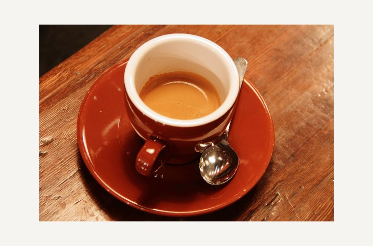</a></td>
<td width="50%" align="center"><a href="cases/coffee-revised-2/generated.png"></a></td>
</tr></tbody>
</table>

[下载左右拼接图](cases/coffee-revised-2/comparison.jpg)

再次生成时，碟子下方仍留出窄条桌面。 杯壁挂痕和匙柄装饰比原图明显。

**中文正向 · 实际输入** · [TXT](cases/coffee-revised-2/positive.zh.txt)

```text
3:2 横幅的暖色咖啡馆实拍。一只红棕色厚瓷小杯连同同色圆碟完整落在画面中央略偏左的位置，从上方向下斜看。杯口横向直径约为画宽的五分之二，上沿距顶边约二十分之一画高，杯内只剩浅浅一层金棕浓缩咖啡和一圈细泡；杯柄朝左下，银色小匙搭在碟子右侧，匙头在右下、柄向右上贴着杯身。红碟宽约占全画宽的三分之二，四边完整可见，底边留一线木桌，右侧露出约五分之一画宽的桌面。蜂蜜色旧木桌的木纹从左下走向右上，左上角露出桌缘外的一小块暗色。斜射暖光照亮杯沿与金属，杯碟左下有深阴影。
```

<details>
<summary>英文正向与中英负面提示词</summary>

**英文正向 · 译文** · [TXT](cases/coffee-revised-2/positive.en.txt)

```text
A warm-toned 3:2 landscape photograph in a café. Viewed obliquely from above, a thick reddish-brown porcelain demitasse and matching round saucer fit entirely within the frame just left of center. The rim spans about two fifths of the image width, and its top sits about one twentieth of the image height below the upper border. Only a shallow layer of golden-brown espresso and a ring of fine bubbles remain. The handle points down and left. A silver teaspoon rests on the right of the saucer, its bowl at the lower right and its handle pointing up and right alongside the cup. The red saucer spans about two thirds of the image width, with all its edges visible, a sliver of wood below it, and about a fifth of the frame width left open on the right. The grain of the old honey-colored wooden table runs from lower left to upper right. A small dark wedge beyond the table edge shows at the upper left. Warm raking light catches the rim and metal, with deep shadows below and to the left of the cup and saucer.
```

**中文负面 · 可选** · [TXT](cases/coffee-revised-2/negative.zh.txt)

```text
正俯视，右侧杯柄，匙头朝上，满杯咖啡，牛奶拉花，碟底出画
```

**英文负面 · 可选** · [TXT](cases/coffee-revised-2/negative.en.txt)

```text
direct overhead view, handle on the right, spoon bowl pointing upward, full cup, milk foam art, saucer cropped at the bottom
```

</details>

原图出自 浓缩咖啡 / Rachel Michetti · Pikolo Espresso Bar / scikit-image。[作品来源](https://scikit-image.org/docs/0.22.x/api/skimage.data.html#skimage.data.coffee) · [案例文件夹](cases/coffee-revised-2)

</details>

页面排版参考 [GPT-Image2-Skill 的案例展示](https://github.com/wuyoscar/GPT-Image2-Skill)。
